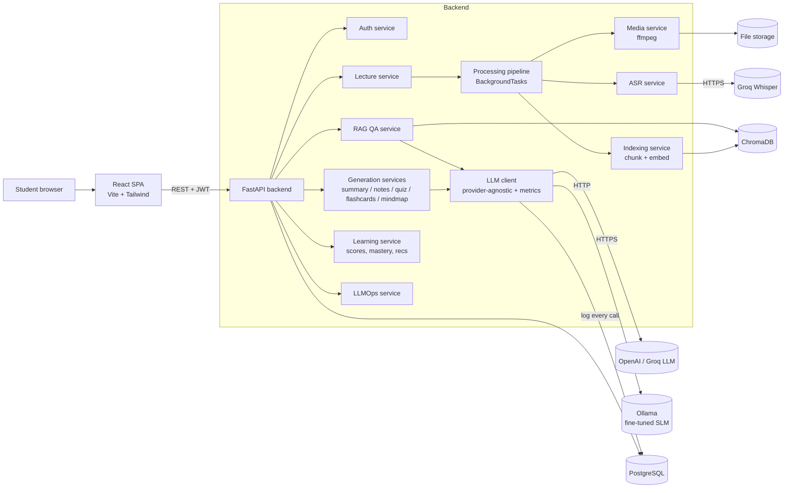
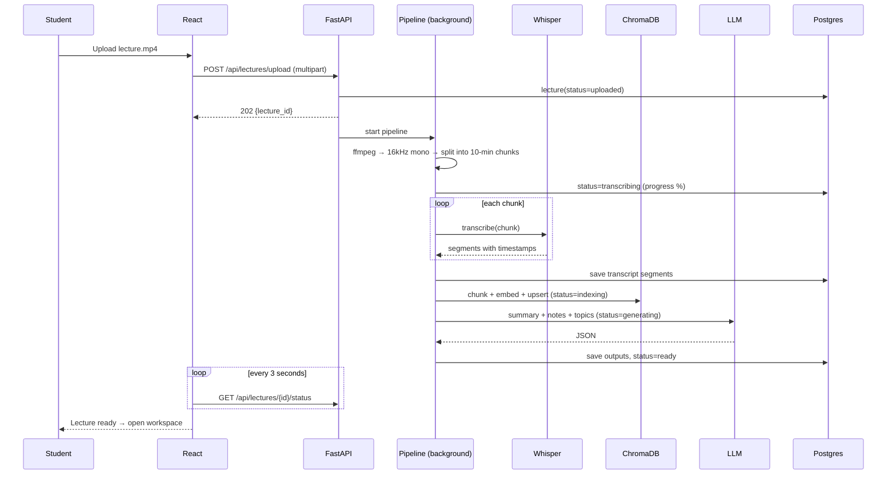
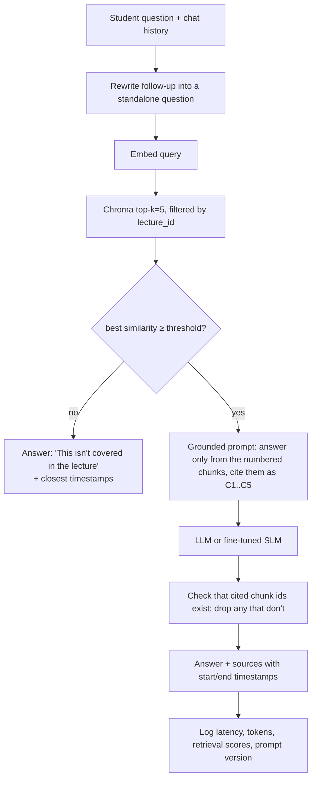

# AI Study Buddy — Implementation Plan

> Put this file in the repo root next to `CLAUDE.md`. Claude Code reads `CLAUDE.md` on its own. Tell it to read this file at the start of every phase.
> Status: **Phase 1 (design) is finished. No code has been written yet.**
> Prices and free-tier limits were checked in Nov 2026. Check them again before you rely on them.

---

## 0. How to use this plan with Claude Code

1. Make an empty folder `ai-study-buddy/`, put both files in it, then run `git init`.
2. Do **one phase per Claude Code session**. Start each one with the phase's "Kickoff prompt" from §12, ideally in **plan mode** (Shift+Tab), so you can check the plan before any files are written.
3. A phase is only done when every item in its **acceptance checks** passes. Run them yourself, not just Claude.
4. After each phase, commit with `git commit -m "phase N: …"` and run `/clear` before you start the next one. That keeps the context small, and the plan and `CLAUDE.md` carry state between sessions.
5. As each phase finishes, tick its box in §13 (Progress log). Claude Code can do this.

---

## 1. Requirements analysis

### 1.1 Requirement traceability matrix

| # | Assignment requirement | How the design meets it | Phase |
|---|---|---|---|
| R1 | Two AI categories: Speech Recognition and NLP | Whisper ASR (speech). LLM, embeddings and SLM (NLP) | 4–7, 10 |
| R2 | At least 5 AI subtasks, each mapped to a model | 7 subtasks, see §2 | 4–7, 10 |
| R3 | Model selection with reasons | §3 | 1 |
| R4 | Stack: React, FastAPI, Postgres, vector DB, Docker | §4. Small changes are justified there | 2–12 |
| R5 | Architecture, components, data flow, API flow | §5 (Mermaid diagrams) | 1 |
| R6 | REST APIs with validation, errors, logging, Swagger | §6. FastAPI generates OpenAPI at `/docs` | 3–7 |
| R7 | LLMOps with at least 5 measured metrics and a dashboard | 8 metrics, all logged automatically, plus an eval harness and a dashboard page (§7) | 3 onward, 11 |
| R8 | Fine-tune an SLM on an education dataset, compare with the base model, use it in the app | SciQ → Qwen3-1.7B with LoRA on Colab T4. Base vs fine-tuned eval. Served through Ollama and selectable in the app (§8) | 10 |
| R9 | Professional SaaS UI with 11 pages | §9 | 8 |
| R10 | Step-by-step phases | §10–§12 | all |
| R11 | Deliverables (report, diagrams, video script, contributions, …) | §11 | 13 |
| R12 | No hardcoded keys, `.env.example`, README, no invented results | Rules in `CLAUDE.md`. Every number comes from logged runs | all |

### 1.2 MVP scope versus stretch goals

**MVP (needed for a passing demo):** auth, upload, transcription with timestamps, summary and notes, quiz with scoring, RAG doubt solver with timestamps and refusals, flashcards, progress dashboard, LLMOps dashboard, fine-tuned SLM selectable in Ask.

**Stretch, in priority order:** mind map → adaptive difficulty and weak-topic recommendations → multi-turn chat memory → spaced-repetition flashcards → cloud deployment → transcript ↔ media player sync.

---

## 2. AI categories and subtask mapping

| # | AI subtask | Category | What it does in the app | Model / tool |
|---|---|---|---|---|
| 1 | **Automatic speech recognition** | Speech Recognition | Lecture audio → text with segment timestamps | Whisper large-v3-turbo through the Groq API (free tier). Fallbacks: local `faster-whisper`, or the OpenAI transcription API |
| 2 | **Abstractive text summarization** | NLP | Short summary, key takeaways, revision notes | Cloud LLM (default `gpt-5-mini`, swappable for a Groq-hosted open model) |
| 3 | **Question generation** | NLP | MCQ, True/False and short-answer questions with explanations at 3 difficulty levels | Cloud LLM with JSON structured output |
| 4 | **Question answering (RAG)** | NLP | Answers grounded in the transcript, with timestamps, and an explicit "not in lecture" refusal | Retriever: Sentence-Transformers + ChromaDB. Generator: cloud LLM **or the fine-tuned SLM** |
| 5 | **Text generation** | NLP | Topic-wise notes, definitions, flashcards | Cloud LLM |
| 6 | **Semantic embeddings / similarity** | NLP | Chunk indexing, retrieval, grading short answers | `BAAI/bge-small-en-v1.5` (local, free) |
| 7 | **Information / keyphrase extraction** | NLP | Topics, concept relations for the mind map, topic tags on each quiz question | Cloud LLM with JSON output |
| + | **Domain fine-tuning** | NLP | Educational grounded-QA SLM | Qwen3-1.7B + LoRA trained on SciQ |

---

## 3. Model selection and reasons

| Need | Choice | Why | Alternatives |
|---|---|---|---|
| ASR | **Groq `whisper-large-v3-turbo`** | Groq has a real free tier with no credit card (around 20 requests/min, 2,000/day, about 2 hours of audio per hour). It uses an OpenAI-compatible endpoint, returns segment timestamps (`verbose_json`), and is very fast. | `faster-whisper` locally (free and offline, slower on CPU). OpenAI transcription at about $0.006/min. |
| ASR limit | Groq's free tier accepts files **up to 25 MB**. The pipeline converts audio to 16 kHz mono with ffmpeg and cuts it into roughly 10-minute pieces, then shifts each piece's timestamps by its start time. | Handles long lectures. | – |
| LLM (summary, quiz, notes, QA) | **Default (free): Groq-hosted `openai/gpt-oss-120b`** (open-weight; Groq free tier, base limits about 30 RPM / 8K TPM / 1K requests per day, checked Nov 2026) behind a provider-agnostic client | $0, OpenAI-compatible endpoint, supports JSON output. The 8K TPM limit means long transcripts must use map-reduce (Phase 5). | **Optional paid:** `gpt-5-mini` with `LLM_PROVIDER=openai`. It is never used as an automatic fallback. Smaller free option: `openai/gpt-oss-20b`. |
| Embeddings | **`BAAI/bge-small-en-v1.5`** via sentence-transformers | Free, runs on CPU, 384 dimensions, good retrieval quality for its size. | `all-MiniLM-L6-v2` (faster), OpenAI `text-embedding-3-small` (paid) |
| Vector DB | **ChromaDB** (persistent, embedded) | Filters by `lecture_id` metadata, stores data on disk, needs no extra server for development, runs in Docker for production. | FAISS, which is faster but has no metadata filtering or persistence built in, so you'd write those yourself. |
| SLM to fine-tune | **Qwen3-1.7B** (fall back to Qwen2.5-1.5B-Instruct if needed) | Small enough for LoRA on a free Colab T4 in under an hour, good instruction following, Apache-2.0 licence, exports to GGUF for Ollama. | Llama-3.2-1B-Instruct, SmolLM2-1.7B |
| Fine-tuning library | **Unsloth + TRL SFTTrainer + PEFT (LoRA)** | Unsloth is about 2× faster and uses about 70% less VRAM, so it fits easily on a T4. | Plain HF Transformers + PEFT (slower) |
| SLM serving | **Ollama** (GGUF export) | Runs on CPU on a laptop and has an OpenAI-compatible API, so the app's LLM client calls it unchanged. | HF `transformers` pipeline inside FastAPI |

**Estimated cost of one 60-minute lecture** (about 13k transcript tokens). This is an estimate to check against the token log, not a measurement: transcription on Groq's free tier is $0. Summary, notes, quiz, flashcards and mind map come to about 5 calls × about 15k input tokens and about 10k output tokens in total, which is roughly **$0.04 with `gpt-5-mini`**. The LLMOps dashboard will show the real figure.

**Decision (Nov 2026): the project runs on free tiers by default.** `LLM_PROVIDER=groq` and `ASR_PROVIDER=groq` are the defaults, so a lecture costs $0. The `gpt-5-mini` estimate above only applies if someone opts in to OpenAI. OpenAI is optional, and the app never switches to it automatically. If Groq rate-limits or a model is unavailable, the app backs off and retries, then returns a clear error.

---

## 4. Technology stack, with the changes explained

| Layer | Proposed | Change from your list, and why |
|---|---|---|
| Frontend | **React 18 + Vite + TypeScript**, Tailwind CSS, **shadcn/ui**, TanStack Query, React Router, **Recharts**, **React Flow** (mind map), Framer Motion, sonner (toasts) | Vite replaces Create React App, which is deprecated. TypeScript catches API contract bugs. shadcn/ui gives you a polished SaaS look quickly. |
| Backend | **FastAPI**, Pydantic v2, **SQLAlchemy 2 + Alembic**, python-jose (JWT), passlib/bcrypt, structlog | Alembic gives you proper database migrations, which looks professional. |
| Background jobs | **FastAPI BackgroundTasks** with job state stored in the database (MVP) | Transcription takes minutes, so the upload returns `202` straight away and the frontend polls for status. Redis and a task queue (arq) are optional extras later. |
| Database | **PostgreSQL 16** (Docker). SQLite only for unit tests | – |
| Vectors | ChromaDB (persistent folder) | – |
| Storage | Local `storage/` folder behind a `StorageService` interface | S3 or Cloudflare R2 can be added later by implementing the same interface. |
| Media | **ffmpeg** | Pulls audio out of MP4, converts to 16 kHz mono, splits into chunks. |
| LLMOps | Your own `llm_calls` and `pipeline_runs` tables, YAML prompt registry, evaluation scripts, dashboard page | Built yourself, which shows the work better than a black-box SaaS. Langfuse is an optional add-on. |
| Testing | pytest + httpx, Vitest, Playwright (one end-to-end smoke test) | – |
| Deployment | Docker Compose (db, backend, frontend/nginx, optional ollama). Cloud: Render, Railway or a small VM | – |

**Phase order change:** the database moves from Phase 9 to **Phase 3**. Every later feature stores data, and adding the database afterwards would mean rewriting things. Phase 9 becomes "vector DB hardening, adaptive learning and progress". §10 has the updated order.

---

## 5. Architecture

### 5.1 System architecture



### 5.2 Components

| Component | Responsibility |
|---|---|
| `api/routers/*` | HTTP layer only: validation, auth, status codes. No business logic. |
| `services/media.py` | ffprobe duration, extract and normalise audio, split into chunks of 25 MB or less |
| `services/asr/` | `ASRProvider` interface with `GroqWhisper`, `LocalFasterWhisper` and `OpenAIWhisper`. Merges chunks and shifts timestamps |
| `services/chunking.py` | Groups transcript segments into windows of about 350 words / 90 s with about 15% overlap, keeping `start`/`end` times |
| `services/embeddings.py` | Loads the sentence-transformer once (singleton) and embeds in batches |
| `services/vectorstore.py` | Chroma wrapper: `add(lecture_id, chunks)`, `query(lecture_id, q, k)`, `delete(lecture_id)` |
| `services/llm/client.py` | One `complete(task, prompt_id, vars, json_schema?)` function. Handles provider routing, retries, JSON validation, and **logs latency, tokens, cost and prompt version** |
| `prompts/*.yaml` | Versioned prompt templates (`id`, `version`, `model`, `system`, `user`, `schema`) |
| `services/generation/*` | Summary and notes (map-reduce over topics when the transcript is long), quiz, flashcards, mind map |
| `services/rag.py` | Retrieve → threshold check → grounded prompt → check citations → answer with timestamps |
| `services/learning.py` | Quiz grading, per-topic mastery, difficulty suggestion, revision recommendations |
| `services/llmops.py` | Aggregate queries for the dashboard, runs the evaluation harness |
| `eval/` | Golden question set, retrieval and faithfulness eval scripts, base-vs-fine-tuned comparison |
| `finetune/` | Colab notebook, data preparation, evaluation scripts, model card |

### 5.3 Lecture processing data flow



### 5.4 RAG doubt-solving flow



### 5.5 API communication pattern
- REST over JSON with `Authorization: Bearer <JWT>`. Uploads use `multipart/form-data`.
- Long jobs return `202`, then the client polls `/status`. This is simpler than WebSockets and reliable for a demo.
- Generation endpoints are **idempotent and cached**: `POST …/summarize` returns the stored result unless `{"regenerate": true}` is sent.
- All errors use one envelope: `{"error": {"code": "LECTURE_NOT_READY", "message": "...", "details": {...}}}`.

---

## 6. REST API specification

Base path `/api`. Every route except auth needs a JWT. Swagger UI is at `/docs`.

| Method | Path | Purpose |
|---|---|---|
| POST | `/auth/register` | Create an account |
| POST | `/auth/login` | Get a JWT |
| GET | `/auth/me` | Current user |
| POST | `/lectures/upload` | Upload MP3, WAV, MP4 or M4A (≤ 500 MB, configurable) → 202 |
| GET | `/lectures` | List the user's lectures with their status |
| GET | `/lectures/{id}` | Lecture metadata |
| GET | `/lectures/{id}/status` | Pipeline stage and progress % |
| DELETE | `/lectures/{id}` | Delete the lecture, its files and its vectors |
| GET | `/lectures/{id}/transcript` | Timestamped segments |
| GET | `/lectures/{id}/transcript/download?format=txt\|srt\|vtt` | File download |
| POST | `/lectures/{id}/summarize` | Summary, key takeaways, definitions, revision notes |
| GET | `/lectures/{id}/notes` | Topic-wise notes |
| POST | `/lectures/{id}/generate-quiz` | Generate a quiz |
| GET | `/quizzes/{quiz_id}` | Quiz without answers |
| POST | `/quizzes/{quiz_id}/submit` | Grade it and return explanations |
| POST | `/lectures/{id}/ask` | Single grounded question |
| POST | `/lectures/{id}/chat` | Multi-turn chat (`session_id`) |
| GET | `/lectures/{id}/chat/{session_id}` | Chat history |
| POST | `/lectures/{id}/flashcards` | Generate a deck |
| POST | `/flashcards/{card_id}/review` | Record knew / didn't know (Leitner box) |
| POST | `/lectures/{id}/mindmap` | Nodes and edges JSON |
| GET | `/lectures/{id}/progress` | Per-lecture mastery and pending topics |
| GET | `/dashboard/overview` | Totals across all lectures |
| GET | `/llmops/metrics?from=&to=&task=` | Aggregated metrics |
| GET | `/llmops/calls` | Raw LLM call log (paginated) |
| POST | `/llmops/eval/run` | Run the evaluation harness on the golden set |
| GET | `/llmops/eval/runs` | Past evaluation results |
| GET | `/models` | Available generators (cloud LLM, fine-tuned SLM, base SLM) |
| GET | `/health` | Liveness check plus database, Chroma and Ollama checks |

### Example contracts (these are request/response **shapes**, not real outputs)

**POST `/api/lectures/upload`** → `202`
```json
{ "lecture_id": "b3f1…", "title": "Intro to Neural Networks", "status": "uploaded", "status_url": "/api/lectures/b3f1…/status" }
```
Errors: `415 UNSUPPORTED_MEDIA_TYPE`, `413 FILE_TOO_LARGE`, `422 VALIDATION_ERROR`.

**GET `/api/lectures/{id}/status`**
```json
{ "status": "transcribing", "progress": 45, "stage_detail": "chunk 3 of 6", "error": null }
```
Stages: `uploaded → extracting_audio → transcribing → indexing → generating → ready | failed`.

**GET `/api/lectures/{id}/transcript`**
```json
{ "lecture_id": "b3f1…", "duration_sec": 3540.2, "language": "en",
  "segments": [ { "id": 0, "start": 0.0, "end": 6.4, "text": "…" } ] }
```

**POST `/api/lectures/{id}/summarize`** request `{ "regenerate": false }` →
```json
{ "summary": "…", "key_takeaways": ["…"], "definitions": [{ "term": "…", "definition": "…", "timestamp": 512.3 }],
  "topics": [{ "title": "…", "notes_md": "…", "start": 300.0, "end": 900.0 }],
  "revision_notes_md": "…", "meta": { "model": "gpt-5-mini", "prompt_version": "summary@v2" } }
```

**POST `/api/lectures/{id}/generate-quiz`**
```json
{ "num_questions": 10, "types": ["mcq", "true_false", "short_answer"], "difficulty": "medium", "topics": null, "adaptive": false }
```
→ `{ "quiz_id": "…", "questions": [{ "id": "q1", "type": "mcq", "difficulty": "medium", "topic": "…", "question": "…", "options": ["A","B","C","D"] }] }` (answers are held back until submission)

**POST `/api/quizzes/{quiz_id}/submit`** `{ "answers": { "q1": "B", "q2": true, "q3": "free text" } }` →
```json
{ "score": 7, "total": 10, "percent": 70.0,
  "results": [{ "id": "q1", "correct": true, "correct_answer": "B", "explanation": "…", "timestamp": 845.0 }],
  "weak_topics": ["Backpropagation"], "suggested_next_difficulty": "medium" }
```
Short answers are graded by the LLM against a rubric (a rule-based embedding-similarity check is the fallback). The result is stored with `graded_by`.

**POST `/api/lectures/{id}/ask`** `{ "question": "…", "model": "cloud" | "finetuned" }` →
```json
{ "answer": "…", "answerable": true,
  "sources": [{ "chunk_id": "C2", "start": 845.0, "end": 932.5, "excerpt": "…", "score": 0.71 }],
  "meta": { "latency_ms": 0, "model": "…", "prompt_version": "rag_answer@v1" } }
```
If `answerable: false`, the answer says plainly that the lecture doesn't cover this and lists the closest timestamps.

---

## 7. LLMOps design (implemented, not just described)

### 7.1 What gets logged automatically
Every LLM, ASR and embedding call goes through one wrapper, which writes a row to **`llm_calls`**:
`id, ts, user_id, lecture_id, task, provider, model, model_version, prompt_id, prompt_version, input_tokens, output_tokens, latency_ms, cost_usd, status, error_type, error_message, request_hash`.
Each pipeline stage writes a row to **`pipeline_runs`**: `lecture_id, stage, started_at, ended_at, duration_ms, audio_sec, status`.
Prices live in `config/pricing.yaml` (dated, easy to edit), so cost is **calculated from real token counts**.

### 7.2 Metrics (8, at least 5 required)

| # | Metric | How it's measured | Where it's shown |
|---|---|---|---|
| M1 | Transcription time and **real-time factor** (processing seconds ÷ audio seconds) | `pipeline_runs` stage = transcribing | Dashboard card + per-lecture bar chart |
| M2 | Summary generation latency (p50/p95) | `llm_calls` task = summary | Latency chart by task |
| M3 | Quiz generation latency (p50/p95) | task = quiz | Same chart |
| M4 | QA response time, end to end (p50/p95) | Timer around the `/ask` handler, including retrieval | Same chart |
| M5 | Tokens and estimated cost per task, per lecture, per day | Sum over `llm_calls` | Stacked bar + total cost card |
| M6 | **Retrieval quality**: Hit@k, MRR and context precision | Eval harness on the golden set (questions labelled with the timestamp range that answers them) | Eval run table |
| M7 | **Faithfulness / hallucination rate** | LLM-as-judge: break the answer into claims, check each against the retrieved chunks, faithfulness = supported ÷ total. Hallucination rate = answers with faithfulness below 1 | Eval run table + trend |
| M8 | **Refusal accuracy** on questions the lecture doesn't answer | The golden set includes off-lecture questions; measure the correct "not in lecture" rate | Eval run table |
| + | Error rate and JSON-parse failure rate per task | `status != ok` | Error panel |

### 7.3 Other LLMOps practices
- **Prompt versioning:** `backend/app/prompts/<id>.yaml` with a `version` field. Each version is logged with every call, and the dashboard can compare metrics between versions.
- **Model version tracking:** the provider's returned model string is logged, plus `FINETUNED_MODEL_TAG` for the SLM.
- **Logging:** structlog JSON logs with a request ID added by middleware.
- **Error tracking:** the global exception handler records the error type, and failed calls show in the dashboard. Sentry is optional.
- **Evaluation:** `python -m eval.run --set golden_v1 --generator cloud|finetuned|base` writes rows to `eval_runs` and `eval_items`.
- **Golden set:** about 30 hand-written questions per demo lecture (20 answerable with timestamp labels, 10 off-lecture), kept in `eval/golden/*.jsonl`. Your team writes these by hand; **Claude must not invent the labels**.

---

## 8. Fine-tuning plan

### 8.1 Dataset: **SciQ** (`allenai/sciq`, about 13.7k crowd-sourced science exam questions)
Each item has a question, a correct answer, 3 distractors and a **support paragraph**.
That support paragraph is the key reason for choosing it: we can train **grounded QA** ("answer using only this context") and **question generation** ("write an MCQ from this passage"). Those are the same two tasks the app does on lecture chunks. The questions are education-level science, so the domain matches.
Backups: ARC-Easy (no context), OpenBookQA (small), or the `squad_v2` unanswerable questions mixed in for refusal behaviour.

### 8.2 Preprocessing
1. Drop rows with an empty `support` (a fair number of rows have none). Report the counts.
2. Build two instruction formats in a chat template:
   - **GQA:** system = "Answer only from the context; if it isn't there, say so." user = `Context: {support}\nQuestion: {question}` → assistant = `{correct_answer}. {one-sentence justification taken from the support}`. Use the support sentence that contains the answer as the justification, so it is derived from the data, not invented.
   - **Refusal (about 15%):** pair a question with a support paragraph from a *different* item → assistant = "The provided context doesn't contain the answer."
   - **QG (optional, about 25%):** context → JSON MCQ using the real distractors.
3. Use the official train/validation/test splits. Keep the test split untouched for the final comparison.
4. Truncate to 1,024 tokens.

### 8.3 Training (Colab T4, free)
- `unsloth/Qwen3-1.7B`, 4-bit QLoRA, r=16, alpha=16, dropout 0, target attention and MLP projections.
- TRL `SFTTrainer`, train on assistant tokens only, lr 2e-4, cosine schedule, 1–2 epochs, effective batch size 16, run validation every N steps, `seed=3407`.
- Save: LoRA adapter → merged model → **GGUF q4_k_m** for Ollama. Push to the Hugging Face Hub (private or public) along with a model card.
- Expect roughly 30–60 minutes of training. Write down the actual time.

### 8.4 Evaluation (base vs fine-tuned, same prompts, same test set)
| Metric | Task |
|---|---|
| Answer accuracy (normalised exact match / contains-match against `correct_answer`) | GQA |
| Token-level F1, ROUGE-L, BERTScore | GQA justification |
| Refusal precision and recall | Refusal subset |
| JSON validity rate, distractor plausibility (spot-checked by hand) | QG |
| Latency per answer on CPU (Ollama) | Serving |
| **In-domain transfer:** M6–M8 on the lecture golden set with `generator=finetuned` against `base` and `cloud` | App |

Save the outputs to `finetune/results/*.json`. The report quotes only those files.

### 8.5 Using it in the app
`ollama create study-buddy-qwen -f Modelfile` → set `FINETUNED_BASE_URL=http://ollama:11434/v1` → on the Ask page, a **"Answer with: Cloud LLM | Fine-tuned SLM | Base SLM"** switch. All three go through the same RAG pipeline and are logged with their model tag, so the LLMOps dashboard shows the comparison live.

---

## 9. Frontend plan

**Look:** dark sidebar with a light content area. Indigo-600 primary, slate neutrals, emerald for success, amber for warnings, rose for errors. Inter font. Rounded-2xl cards with soft shadows. Skeleton loaders. Empty states with illustrations. Toasts for success and errors. Responsive: the sidebar collapses into a drawer below `md`.

| Page | Route | Key elements |
|---|---|---|
| Login / Register | `/login`, `/register` | Split-screen hero, form validation |
| Dashboard | `/` | KPI cards (lectures, average score, cards due, study streak), recent lectures, weak topics, score trend (Recharts) |
| Upload | `/upload` | Drag and drop, file checks, upload progress bar |
| Processing status | `/lectures/:id/processing` | Animated stage stepper with progress % and an error/retry state |
| Lecture workspace | `/lectures/:id/*` | Tabs: **Transcript · Summary & Notes · Quiz · Ask · Flashcards · Mind Map** |
| Transcript | `…/transcript` | Searchable segments, clickable timestamps (media player seeks there), download as TXT/SRT/VTT |
| Summary & Notes | `…/notes` | Summary, takeaways, definitions glossary, topic accordion, copy/export to Markdown |
| Quiz | `…/quiz` | Setup panel (types, difficulty, adaptive toggle) → one question at a time → results with explanations and "jump to timestamp" |
| Ask (chat) | `…/ask` | Chat bubbles, source chips with timestamps, model switch, "not in lecture" badge |
| Flashcards | `…/flashcards` | 3D flip card, keyboard shortcuts, Leitner boxes, "due today" |
| Mind map | `…/mindmap` | React Flow with auto layout (dagre), click a node to see its notes |
| Analytics | `/analytics` | Mastery by topic (radar/bar), quiz history, revision done vs pending |
| LLMOps | `/llmops` | Metric cards, latency by task, cost, error log table, eval runs, model comparison |

---

## 10. Development roadmap (updated order)

| Phase | Name | Main output | Depends on |
|---|---|---|---|
| 1 | Planning & design | This document ✅ | – |
| 2 | Scaffold & environment | Monorepo, Docker Postgres, `.env.example`, health check, frontend shell | 1 |
| 3 | Backend core + **database** | Settings, DB models + Alembic, auth (JWT), error envelope, logging, `llm_calls` table, LLM client wrapper | 2 |
| 4 | Upload & transcription | Media service, ASR providers, pipeline with status, transcript endpoints and downloads | 3 |
| 5 | Summary & notes | Prompt registry, summary/notes/topics with map-reduce, caching | 4 |
| 6 | Quiz & flashcards | Quiz generation, grading, attempts; flashcards with review | 5 |
| 7 | RAG doubt solver & chat | Chunking, embeddings, Chroma, grounded answers, refusal, chat sessions | 4 |
| 8 | React frontend | All pages wired to the API | 3–7 |
| 9 | Learning features & vector hardening | Mastery, adaptive difficulty, recommendations, mind map, re-indexing, cleanup on delete | 6–8 |
| 10 | Fine-tuning | Colab notebook, eval results, Ollama integration, model switch | 7 |
| 11 | LLMOps dashboard & evaluation | Metrics API, eval harness, golden set, dashboard page | 3–10 |
| 12 | Docker & deployment | Compose for the full stack, production builds, optional cloud deploy | all |
| 13 | Testing & deliverables | Test suites, screenshots, report, video script | all |

**Suggested schedule (about 5 weeks, team of 3–4):** Week 1: phases 2–4 · Week 2: 5–7 · Week 3: 8 (start 10 in parallel on Colab) · Week 4: 9–11 · Week 5: 12–13.

---

## 11. Repository layout

```
ai-study-buddy/
├── CLAUDE.md
├── IMPLEMENTATION_PLAN.md
├── README.md
├── .env.example
├── docker-compose.yml
├── backend/
│   ├── pyproject.toml | requirements.txt
│   ├── alembic/ , alembic.ini
│   ├── app/
│   │   ├── main.py            # app factory, middleware, routers
│   │   ├── core/              # config.py, security.py, logging.py, errors.py
│   │   ├── db/                # session.py, base.py
│   │   ├── models/            # SQLAlchemy models
│   │   ├── schemas/           # Pydantic request/response
│   │   ├── api/routers/       # auth, lectures, quizzes, flashcards, chat, llmops, models, health
│   │   ├── services/          # media, asr/, chunking, embeddings, vectorstore, llm/, generation/, rag, learning, llmops, storage
│   │   ├── prompts/           # *.yaml versioned prompts
│   │   └── workers/pipeline.py
│   ├── config/pricing.yaml
│   ├── eval/                  # golden/, run.py, metrics.py
│   └── tests/
├── frontend/
│   ├── package.json, vite.config.ts, tailwind.config.ts
│   └── src/ (api/, components/, features/<area>/, pages/, hooks/, lib/, routes.tsx)
├── finetune/
│   ├── sciq_finetune_colab.ipynb
│   ├── prepare_data.py, evaluate.py, Modelfile, MODEL_CARD.md
│   └── results/               # only real outputs go here
├── storage/                   # gitignored: uploads/, audio/, chroma/
├── dev-log/                   # gitignored, private per-phase development log (never committed)
└── docs/                      # architecture.md, api.md, llmops.md, finetuning.md, screenshots/, report/, demo_script.md, contributions.md
```

### Main database tables
`users` · `lectures(id, user_id, title, media_path, duration_sec, status, progress, error)` · `transcript_segments(lecture_id, idx, start, end, text)` · `chunks(id, lecture_id, idx, start, end, text, vector_id)` · `lecture_outputs(lecture_id, kind[summary|notes|mindmap], content_json, prompt_version, model)` · `quizzes / quiz_questions(topic, difficulty, type, answer, explanation, source_start)` · `quiz_attempts / attempt_answers` · `flashcards(lecture_id, front, back, topic, box, due_at)` · `topic_mastery(user_id, lecture_id, topic, score_ema, attempts)` · `chat_sessions / chat_messages(sources_json)` · `llm_calls` · `pipeline_runs` · `eval_runs / eval_items`

---

## 12. Phase-by-phase kickoff prompts for Claude Code

Paste a prompt at the start of a fresh session. Each one ends with checks you confirm yourself.

### Phase 2: Scaffold & environment
```
Read IMPLEMENTATION_PLAN.md (§4, §11) and CLAUDE.md. Implement Phase 2 only.
Create the monorepo layout from §11. Backend: FastAPI app factory with GET /api/health, a pydantic-settings config that reads .env, requirements.txt with pinned versions, and a pytest config with one health test.
Frontend: Vite + React + TS + Tailwind + shadcn/ui init, React Router, an app shell with a sidebar layout and placeholder pages for every route in §9.
docker-compose.yml with only postgres:16 for now. Root .env.example listing every variable from CLAUDE.md, .gitignore, and a README section "Local setup" with exact commands for Windows, macOS and Linux.
Explain each file you create in one line. Finish by listing the commands I need to run to verify.
```
**Checks:** `docker compose up -d db` works · `uvicorn app.main:app --reload` → `/api/health` returns 200 · `/docs` loads · `pytest` passes · `npm run dev` shows the sidebar shell.

### Phase 3: Backend core and database
```
Implement Phase 3: SQLAlchemy 2 models for every table in §11, an Alembic initial migration, a session dependency.
Auth: register/login/me with bcrypt + JWT. Global error envelope (§5.5) and exception handlers. structlog JSON logging with request-id middleware.
LLM client wrapper (services/llm/client.py) supporting providers openai | groq | ollama via the OpenAI SDK with base_url. It loads prompts from app/prompts/*.yaml, validates JSON output against a Pydantic schema with one repair retry, and writes every call to llm_calls with tokens, latency, cost (from config/pricing.yaml) and prompt version.
Add tests for auth and for the LLM client, using a fake provider (no network in tests).
```
**Checks:** `alembic upgrade head` creates the tables · you can register and log in through Swagger · a test proves an `llm_calls` row is written.

### Phase 4: Upload and transcription
```
Implement Phase 4: POST /lectures/upload (type and size validation, stored through StorageService), the background pipeline with the status stages from §6, media.py (ffprobe, ffmpeg extract to 16kHz mono, split into chunks ≤ 24 MB / about 10 min),
an ASR provider interface with GroqWhisper (verbose_json segments), LocalFasterWhisper and OpenAIWhisper, chosen by ASR_PROVIDER. Shift segment timestamps by each chunk's offset and merge them.
Save transcript_segments and pipeline_runs timings. Endpoints: list/get/status/delete lecture, transcript, and download as txt/srt/vtt.
Retry on 429 with backoff. Add a tests/fixtures short audio generator (ffmpeg sine or TTS is fine), and mock the ASR in unit tests.
Give me a manual test script using curl against a real 2-minute recording.
```
**Checks:** upload a real 5–10 minute MP3 and an MP4 → status reaches `transcribing → ready-for-indexing` · the timestamps are continuous across chunk boundaries · the SRT opens in VLC.

### Phase 5: Summary and notes
```
Implement Phase 5: prompts summary.yaml, notes.yaml and topics.yaml (versioned). For transcripts longer than about 12k tokens, use map-reduce: summarise ~10-minute windows, then merge.
Output schema as in §6 /summarize, including timestamps for definitions and topics, taken from the window they came from (never invented).
Cache results in lecture_outputs and honour regenerate=true. The pipeline runs summary + topics automatically after transcription and then sets status=ready.
Every claim must come from the transcript: tell the model not to add outside facts and to put "(not stated in lecture)" if a definition is incomplete.
```
**Checks:** the summary reads correctly against your lecture · the topic timestamps fall inside the lecture's duration · a second call is instant (cached) · rows appear in `llm_calls`.

### Phase 6: Quiz and flashcards
```
Implement Phase 6: quiz generation (mcq/true_false/short_answer × easy/medium/hard) with JSON schema: each question has topic, answer, explanation, source_start. Check that MCQs have 4 unique options and the answer is among them; regenerate any invalid items.
Quiz get (answers hidden), submit (grading; short answers graded by the LLM with a rubric and an embedding-similarity fallback), attempts stored, and topic_mastery updated with an EMA.
Flashcards: generate a deck (definitions + concepts, no duplicates), review endpoint with 5 Leitner boxes and due_at.
```
**Checks:** a generated quiz has no invalid items · submitting returns a score and explanations · mastery rows update.

### Phase 7: RAG doubt solver and chat
```
Implement Phase 7: chunking.py (segment windows of about 350 words / 90 s with about 15% overlap, keeping start/end), embeddings.py (bge-small singleton, normalized), vectorstore.py (Chroma persistent, collection per environment, metadata lecture_id).
The pipeline indexes after transcription. rag.py follows §5.4 exactly: follow-up rewrite, top-k=5, similarity threshold from env (RAG_MIN_SCORE, default 0.35, to be tuned in Phase 11), grounded prompt with numbered chunks, citation check, and a refusal path.
Endpoints /ask and /chat with stored sessions and messages. The generator can be chosen: cloud | finetuned | base (finetuned and base go through the ollama provider and return 503 MODEL_UNAVAILABLE with a clear message if Ollama isn't running).
Tests: a refusal for an off-topic question when using a fake retriever with low scores.
```
**Checks:** an on-topic question returns correct timestamps · "Who won the 2022 World Cup?" asked about a biology lecture returns `answerable:false` · follow-up questions work.

### Phase 8: React frontend
```
Implement Phase 8 using the §9 page list and visual style. Typed API client (axios + TanStack Query) with JWT handling, a 401 redirect, and error and success toasts.
Build every page; the processing stepper polls status every 3 seconds; the transcript has a media player that seeks when a timestamp is clicked; the quiz flow, chat with source chips, flip flashcards and dashboard charts all use real API data.
No mock data in finished pages. Include loading skeletons and empty states. Make sure it's responsive down to 375px.
```
**Checks:** complete the whole flow in the browser: register → upload → processing → each tab works → the dashboard updates.

### Phase 9: Learning features and vector hardening
```
Implement Phase 9: the mind map endpoint (topics → hierarchical nodes and edges with relation labels, validated as a tree plus optional cross-links) and the React Flow page with dagre layout.
Adaptive quiz: when adaptive=true, pick topics weighted by low mastery and difficulty by mastery (<0.5 easy, 0.5–0.8 medium, >0.8 hard). /progress and /dashboard/overview with weak topics, revision done vs pending, and cards due.
Deleting a lecture also deletes its vectors and files. Re-index endpoint.
```

### Phase 10: Fine-tuning (Colab, then local)
```
Implement Phase 10 from §8: finetune/prepare_data.py, the notebook sciq_finetune_colab.ipynb (Unsloth, Qwen3-1.7B, QLoRA, settings exactly as in §8.3, logs train/val loss, saves adapter, merged model, GGUF q4_k_m), evaluate.py comparing base vs fine-tuned on the SciQ test split with §8.4 metrics and writing finetune/results/*.json, a Modelfile for Ollama, and a MODEL_CARD.md template with placeholders ONLY.
Do not write any numbers into docs; they must come from results files after I run the notebook.
```
**You do:** run the notebook on Colab (T4) → download the GGUF → `ollama create study-buddy-qwen -f finetune/Modelfile` → test the switch on the Ask page.

### Phase 11: LLMOps dashboard and evaluation
```
Implement Phase 11 from §7: /llmops endpoints (p50/p95 latency per task, tokens, cost, error rate, RTF), the eval harness (eval/run.py) computing Hit@k, MRR, context precision, faithfulness (LLM-as-judge claim checking with a versioned judge prompt), and refusal accuracy for the generators cloud|finetuned|base. Store results in eval_runs/eval_items.
The LLMOps React page with cards, charts, an error table, eval runs, and a model comparison table. Add a script to export a metrics snapshot to docs/llmops_results.md, generated from the database, not handwritten.
Golden set format eval/golden/<lecture>.jsonl: {question, answerable, gold_start, gold_end, reference_answer}. Create an EMPTY template plus instructions; I will write the questions.
```

### Phase 12: Docker and deployment
```
Implement Phase 12: backend Dockerfile (python slim + ffmpeg, non-root, model cache volume), frontend multi-stage build served by nginx with /api proxy, compose services db, backend, frontend and an optional ollama profile, healthchecks, named volumes for postgres, storage and chroma.
`docker compose up --build` must run the whole app. Add a deploy guide for one free/cheap host (Render or a small VM), with the trade-offs.
```

### Phase 13: Testing and deliverables
```
Implement Phase 13: raise backend test coverage on services (report the coverage %), add Vitest component tests for the quiz and chat, and one Playwright smoke test of the full flow with a short fixture lecture.
Write docs/: architecture.md (Mermaid from §5), api.md (exported from OpenAPI), llmops.md, finetuning.md (filled ONLY from results files), testing.md (real test output), demo_script.md (5–7 minute video script), contributions.md template.
Then draft the technical report as a Word document, using only real results.
```

---

## 13. Final deliverables mapped to requirements

| Deliverable | Source in the repo | Meets |
|---|---|---|
| Working application | `docker compose up` + README | R4, R9 |
| Architecture diagrams | `docs/architecture.md` (Mermaid → PNG for the report) | R5 |
| AI category and subtask mapping | §2 → report chapter 3 | R1, R2 |
| Model selection and reasons | §3 → report chapter 4 | R3 |
| REST API docs | `/docs` Swagger + `docs/api.md` | R6 |
| Dataset and fine-tuning docs | `finetune/MODEL_CARD.md`, `results/*.json`, `docs/finetuning.md` | R8 |
| LLMOps implementation and metrics | `/llmops` page + `docs/llmops_results.md` | R7 |
| Screenshots | `docs/screenshots/` (taken in Phase 13) | R9 |
| Testing results | `docs/testing.md` (pytest/Vitest/Playwright output, coverage) | R11 |
| Technical report (Word/PDF) | `docs/report/` | R11 |
| Demo video script | `docs/demo_script.md` | R11 |
| Group contributions | `docs/contributions.md`. A suggested split: **A** backend + ASR + RAG, **B** frontend + UX, **C** fine-tuning + evaluation, **D** LLMOps + DevOps + report. Fill it in with what each person actually did | R11 |

### Main risks and how to handle them
| Risk | Mitigation |
|---|---|
| Groq free-tier limits or outages | `ASR_PROVIDER` switch to local `faster-whisper` or OpenAI; record demo lectures ahead of time |
| LLM returns invalid JSON | Structured output + Pydantic validation + one repair retry + logged parse failures |
| Hallucinated answers | Similarity threshold, citation check, refusal path, faithfulness eval |
| The fine-tuned SLM is slow on CPU | 1.7B at q4 GGUF; cap `max_tokens`; demo on short answers; show latency honestly in the dashboard |
| Colab session times out | Save checkpoints to Google Drive every N steps |
| Copyright of demo lectures | Use your own recorded lecture or openly licensed material (for example MIT OCW, CC BY-NC-SA, with credit) |

---

## 14. Progress log
- [x] Phase 1: Planning & design
- [ ] Phase 2: Scaffold & environment
- [ ] Phase 3: Backend core + database
- [ ] Phase 4: Upload & transcription
- [ ] Phase 5: Summary & notes
- [ ] Phase 6: Quiz & flashcards
- [ ] Phase 7: RAG & chat
- [ ] Phase 8: Frontend
- [ ] Phase 9: Learning features
- [ ] Phase 10: Fine-tuning
- [ ] Phase 11: LLMOps & eval
- [ ] Phase 12: Docker & deploy
- [ ] Phase 13: Testing & deliverables

### Decisions still open (confirm before Phase 2)
1. ~~LLM provider~~ **Decided:** free Groq by default (`openai/gpt-oss-120b` + `whisper-large-v3-turbo`). OpenAI is optional, opt-in only, and never a fallback.
2. Team size and how roles are split.
3. Deadline (adjusts the schedule in §10).
4. Laptop OS and RAM. 8 GB or more is fine for Ollama with the 1.7B q4 model.
