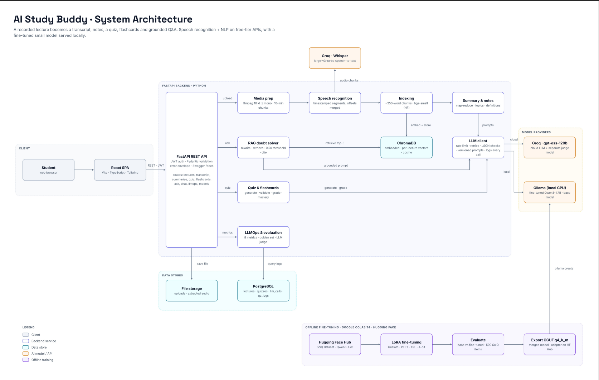

# AI Study Buddy

A web app that turns recorded lectures into **timestamped transcripts, notes, quizzes, flashcards and a grounded
Q&A chat**. It also includes an **LLMOps dashboard** and a **fine-tuned small language model** (Qwen3-1.7B on SciQ).
Everything the app generates comes from the lecture itself, and every timestamp comes from the transcript.

**Runs on free tiers by default.** Groq serves speech recognition (`whisper-large-v3-turbo`) and the LLM
(`openai/gpt-oss-120b`, an open-weight model hosted on Groq). Embeddings and the fine-tuned model run locally.
OpenAI is optional, used only if you set it explicitly, and never used as an automatic fallback.



## Features

| Feature | What it does | Screenshot |
|---|---|---|
| Upload and processing | Upload MP3, WAV, MP4 or M4A. A background pipeline extracts the audio (ffmpeg), transcribes it (Groq Whisper), indexes it for search and writes the notes; a stage stepper shows progress | [processing](docs/images/processing.png) |
| Transcript | Timestamped segments, search, a media player that jumps to any segment, TXT/SRT/VTT download | [transcript](docs/images/transcript.png) |
| Summary and notes | Summary, key takeaways, definitions glossary, topic-wise notes with times, revision notes, Markdown export | [notes](docs/images/notes.png) |
| Quizzes | MCQ, true/false and short-answer questions at three difficulty levels, validated before you see them; graded with explanations, "jump to timestamp" and topic mastery | [setup](docs/images/quiz_setup.png) · [results](docs/images/quiz.png) |
| Flashcards | A deck from the lecture, keyboard flip, Leitner boxes and "due today" | [flashcards](docs/images/flashcards.png) |
| Ask (grounded chat) | Answers only from the lecture, with timestamped sources; says clearly when the lecture doesn't cover a question; follow-up questions; choose the cloud LLM, the fine-tuned SLM or the base SLM | [answer](docs/images/ask.png) · [refusal](docs/images/ask_refusal.png) · [fine-tuned model](docs/images/ask_models.png) |
| Dashboard and analytics | Lectures, quiz scores, cards due, weak topics, mastery by topic | [dashboard](docs/images/dashboard.png) · analytics (screenshot to come: `docs/images/analytics.png`) |
| LLMOps | Latency (p50/p95) per task and model, tokens and cost, errors, refusals, prompt and model versions, golden-set evaluation of cloud vs fine-tuned vs base | [llmops](docs/images/llmops.png) · [evaluation](docs/images/llmops_eval.png) |
| Docker | The whole stack with `docker compose up --build` | [compose ps](docs/images/docker_ps.png) · [Docker Desktop](docs/images/docker_desktop.png) |
| REST API | 39 documented endpoints, Swagger UI at `/docs`, one error format | screenshot to come: `docs/images/swagger.png` |

Not built (future work, Phase 9): the mind map, adaptive quiz difficulty and study recommendations.

## Documentation

| Topic | Document |
|---|---|
| Architecture, data flow, RAG flow | [docs/architecture.md](docs/architecture.md) |
| AI categories, subtasks and Hugging Face map | [docs/ai_mapping.md](docs/ai_mapping.md) |
| Model selection and free-tier limits | [docs/model_selection.md](docs/model_selection.md) |
| REST API · OpenAPI file | [docs/api.md](docs/api.md) · [docs/openapi.json](docs/openapi.json) |
| Summary and notes · quizzes and flashcards · Q&A and chat | [docs/summarization.md](docs/summarization.md) · [docs/quizzes.md](docs/quizzes.md) · [docs/rag.md](docs/rag.md) |
| Fine-tuning · model card | [docs/finetuning.md](docs/finetuning.md) · [finetune/MODEL_CARD.md](finetune/MODEL_CARD.md) · [finetune/README.md](finetune/README.md) |
| LLMOps: metrics · results (generated) | [docs/llmops.md](docs/llmops.md) · [docs/llmops_results.md](docs/llmops_results.md) |
| Testing | [docs/testing.md](docs/testing.md) |
| Docker and deployment | [docs/deployment.md](docs/deployment.md) |
| Requirements traceability | [docs/requirements_traceability.md](docs/requirements_traceability.md) |
| Demo script · team contributions | [docs/demo_script.md](docs/demo_script.md) · [docs/contributions.md](docs/contributions.md) |
| Technical report (Word) | [docs/report/AI_Study_Buddy_Report.docx](docs/report/AI_Study_Buddy_Report.docx) |
| Design and phase plan · contributor rules | [IMPLEMENTATION_PLAN.md](IMPLEMENTATION_PLAN.md) · [CLAUDE.md](CLAUDE.md) |

## Stack

React 18 + Vite + TypeScript · Tailwind CSS v4 · shadcn/ui · TanStack Query · React Router · Recharts ·
FastAPI · Pydantic v2 · SQLAlchemy 2 + Alembic · PostgreSQL 16 · ChromaDB · sentence-transformers
(`BAAI/bge-small-en-v1.5`) · ffmpeg · Groq API · Ollama · Unsloth + TRL + PEFT (fine-tuning on Colab) · Docker Compose

## Quick start with Docker

Needs only Docker and a free Groq API key from https://console.groq.com/keys. The commands are the same in
PowerShell, macOS and Linux, except for copying the settings file:

| Windows (PowerShell) | macOS / Linux |
|---|---|
| `Copy-Item .env.example .env` | `cp .env.example .env` |

Put your key in `.env` (`GROQ_API_KEY=...`), then:

```bash
docker compose up --build -d
docker compose ps        # wait until every service shows "healthy"
```

Open http://localhost:8080 and register an account (Swagger: http://localhost:8080/docs). Stop with
`docker compose down`; your data stays in Docker volumes.

The **fine-tuned and base models** run in Ollama. By default the backend uses the Ollama on your computer; see
[docs/deployment.md](docs/deployment.md#3-the-local-models-ollama) to load the GGUF files or to run Ollama in a
container. Without Ollama, the app works with the cloud model and the two local options return a clear
"model unavailable" message.

Already used the app in development? Copy your uploads and vectors into the volumes once with
`docker compose --profile seed run --rm seed`.

## Native setup (for development)

### 1. Prerequisites

| Tool | Version | Windows (PowerShell) | macOS | Linux (Debian/Ubuntu) |
|---|---|---|---|---|
| Git | any recent | `winget install -e --id Git.Git` | `brew install git` | `sudo apt install git` |
| Python | 3.11+ (3.12 used) | `winget install -e --id Python.Python.3.12` | `brew install python@3.12` | `sudo apt install python3.12 python3.12-venv` |
| Node.js | 22.12+ or 24 LTS | `winget install -e --id OpenJS.NodeJS.LTS` | `brew install node@24` | [nodesource](https://github.com/nodesource/distributions) or `nvm install 24` |
| Docker | Desktop / Engine (for PostgreSQL) | `wsl --install` (admin, then reboot), then `winget install -e --id Docker.DockerDesktop` | `brew install --cask docker` | [Docker Engine docs](https://docs.docker.com/engine/install/) |
| ffmpeg | any recent | `winget install -e --id Gyan.FFmpeg` | `brew install ffmpeg` | `sudo apt install ffmpeg` |
| Ollama (optional) | for the fine-tuned model | `winget install -e --id Ollama.Ollama` | `brew install ollama` | [ollama.com/download](https://ollama.com/download) |

Open a new terminal after installing so your `PATH` is updated.

### 2. Clone and configure

```bash
git clone https://github.com/pranavshinde16/AI-study-buddy.git
cd AI-study-buddy
```

Copy `.env.example` to `.env` (table above) and add your Groq key. Every setting is explained in
[.env.example](.env.example).

### 3. Database

```bash
docker compose up -d db
docker compose ps        # STATUS should show "healthy"
```

### 4. Backend

**Windows (PowerShell)**
```powershell
cd backend
py -3.12 -m venv .venv
.\.venv\Scripts\Activate.ps1
pip install -r requirements.txt
alembic upgrade head
uvicorn app.main:app --reload
```

**macOS / Linux**
```bash
cd backend
python3.12 -m venv .venv
source .venv/bin/activate
pip install -r requirements.txt
alembic upgrade head
uvicorn app.main:app --reload
```

- If PowerShell refuses to run `Activate.ps1`, run `Set-ExecutionPolicy -Scope CurrentUser RemoteSigned` once.
- `pip install` includes PyTorch (CPU) for the embedding model, which takes a few minutes. On Linux, run
  `pip install torch==2.14.1 --index-url https://download.pytorch.org/whl/cpu` first to avoid about 2 GB of CUDA packages.
- Run `alembic upgrade head` again after every `git pull` that adds a migration.
- Check: http://localhost:8000/api/health returns `"status": "ok"`, and http://localhost:8000/docs shows Swagger UI.

### 5. Frontend (second terminal, same commands on every OS)

```bash
cd frontend
npm install
npm run dev
```

Open http://localhost:5173. Requests to `/api/*` go to the backend at `API_PROXY_TARGET` (default
`http://localhost:8000`; change it in `frontend/.env`, see `frontend/.env.example`).

### 6. Fine-tuned model (optional)

The GGUF files are not in git (about 1 GB each). Put the fine-tuned GGUF (from the Colab run or the team's private
Hugging Face repo) in `finetune/`, then:

```bash
cd finetune
ollama create study-buddy-qwen -f Modelfile
```

The base model is built from Ollama's `qwen3:1.7b` with the same chat template; the steps for both models, with
PowerShell and macOS/Linux commands, are in [finetune/README.md](finetune/README.md). How the model was trained
and evaluated: [docs/finetuning.md](docs/finetuning.md).

## Tests

```bash
cd backend && pytest -q                           # add --cov=app for coverage
cd frontend && npm test && npm run typecheck && npm run lint
```

No test calls a real provider or needs a Groq key. Latest results and coverage: [docs/testing.md](docs/testing.md).

## Useful scripts (backend, virtual environment active)

| Command | What it does |
|---|---|
| `python -m scripts.llm_smoke` | One small request to Groq to check your key (logged in `llm_calls`) |
| `python -m scripts.embedding_smoke` | Downloads and checks the local embedding model |
| `python -m scripts.calibrate_rag --lecture-id <id>` | Retrieval scores of on- and off-topic questions, to check `RAG_MIN_SCORE` ([rag.md](docs/rag.md#3-calibrating-rag_min_score)) |
| `python -m eval.run --set ci_lecture --lecture-id <id> --generator all` | Golden-set evaluation ([llmops.md](docs/llmops.md)) |
| `python -m scripts.export_llmops` | Regenerates [docs/llmops_results.md](docs/llmops_results.md) from the database |
| `python -m scripts.export_openapi` | Regenerates [docs/openapi.json](docs/openapi.json) |
| `scripts/manual_phase4.*` … `manual_phase7.*` | Scripted end-to-end checks against a running server (`.ps1` on Windows, `.sh` on macOS/Linux) |

Offline speech recognition (optional): `pip install -r requirements-asr-local.txt` and set `ASR_PROVIDER=local`.

## Repository layout

```
backend/    FastAPI app (app/), migrations (alembic/), eval harness (eval/), scripts, tests
frontend/   React + Vite app, nginx config for Docker
finetune/   Colab notebook, data preparation, evaluation, model card, results/
docs/       documentation, images, report
```

Details: [IMPLEMENTATION_PLAN.md §11](IMPLEMENTATION_PLAN.md#11-repository-layout).

## Project status

Phases 1–8 and 10–13 are complete. Phase 9 (mind map, adaptive learning) was skipped and is listed as future work.
Progress log: [IMPLEMENTATION_PLAN.md §14](IMPLEMENTATION_PLAN.md#14-progress-log).

## Licences and data

The fine-tuned model is trained on SciQ (CC-BY-NC-3.0), so it is for non-commercial use. Lecture recordings are
not in the repository (`media-files/` and `storage/` are gitignored).
