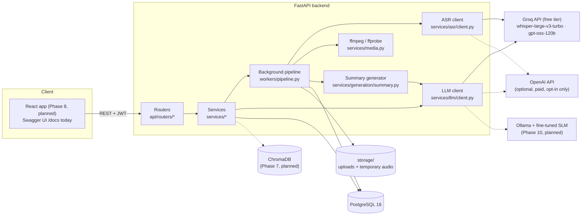
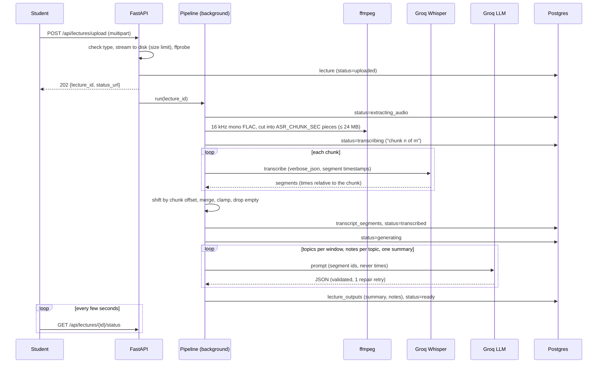
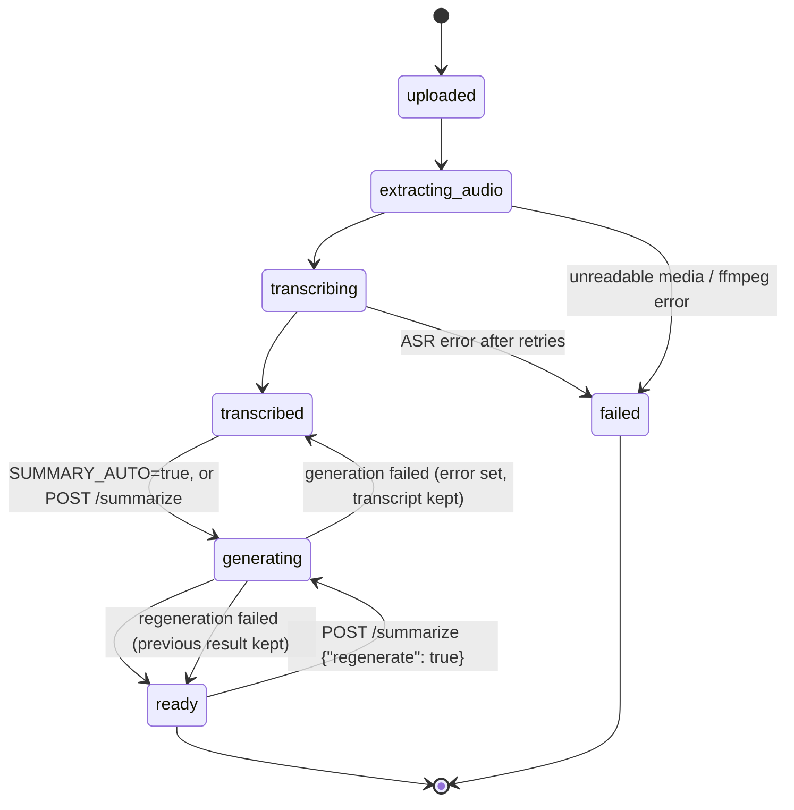

# Architecture

This page describes the backend as built through **Phase 5** (upload, transcription, summary and notes). Parts that later phases add are marked *(planned)*. The full design and phase plan live in [IMPLEMENTATION_PLAN.md](../IMPLEMENTATION_PLAN.md).

## 1. System overview



Dashed arrows are used only when you configure them explicitly. The app **never switches provider on its own**: when Groq rate-limits or a model is unavailable, the request fails with a clear error (`429 RATE_LIMITED`, `503 MODEL_UNAVAILABLE`) instead of falling back to a paid API.

## 2. Backend layers

| Layer | Folder | Responsibility |
|---|---|---|
| Routers | `app/api/routers/` | HTTP only: parse and validate input, call a service, shape the response. No business logic. |
| Dependencies | `app/api/deps.py` | DB session, settings, current user (JWT), storage, ffmpeg wrapper, pipeline, generator. Tests override these. |
| Schemas | `app/schemas/` | Pydantic request/response models (shown in Swagger). |
| Services | `app/services/` | Business logic: `auth`, `lectures`, `summaries`, `storage`, `media`, `transcript_format`, `asr/`, `llm/`, `generation/`. |
| Worker | `app/workers/pipeline.py` | The lecture pipeline, run by FastAPI `BackgroundTasks`. |
| Models | `app/models/` | SQLAlchemy 2 tables; migrations in `alembic/versions/`. |
| Core | `app/core/` | Settings (`config.py`), error envelope, structlog logging, request-id middleware, password hashing and JWT. |
| Prompts | `app/prompts/*.yaml` | Versioned prompt templates (`id`, `version`). |

Every error, from any layer, is returned as `{"error": {"code", "message", "details"}}`.

## 3. Lecture pipeline



Each stage writes a `pipeline_runs` row (start, end, duration, audio seconds), and every request to a model writes an `llm_calls` row (see §5).

### Status values



- `transcribed` with a non-null `error` means the transcript is available but the summary failed. Retry with `POST /api/lectures/{id}/summarize`.
- On startup, lectures left in `uploaded`, `extracting_audio` or `transcribing` by a restart are marked `failed` (background tasks cannot resume). Lectures left in `generating` go back to `transcribed`.
- `indexing` (vector store) is added between `transcribed` and `generating` in Phase 7 *(planned)*.

## 4. Grounding rules (how the app avoids invented content)

1. **Timestamps come only from ASR segments.** Whisper returns segment start/end times per chunk; the pipeline adds the chunk's offset. A provider that returns text without segments is rejected rather than given made-up times.
2. **The LLM never writes times.** Prompts show the transcript as `[segment id] text` lines and ask for segment ids. The app converts ids to times by looking up the stored segments; ids outside the window are clamped to it, and a definition with an invalid id gets `timestamp: null`.
3. **Only the transcript is used.** Each prompt tells the model to use only the transcript, add no outside knowledge, and write `(not stated in lecture)` where the lecturer left something incomplete.
4. **Prompts are versioned.** Every call logs `prompt_id@version`, so results can be traced to the exact prompt.

Details: [summarization.md](summarization.md).

## 5. Model calls and LLMOps logging

All model calls go through two wrappers. No other code calls an SDK directly.

| Wrapper | Used for | Providers |
|---|---|---|
| `services/llm/client.py` → `LLMClient.complete()` | topics, notes, summary (later: quiz, RAG, judge) | `groq` (default), `openai` (opt-in), `ollama` (Phase 10) |
| `services/asr/client.py` → `ASRClient.transcribe_chunk()` | speech-to-text | `groq` (default), `openai` (opt-in), `local` (faster-whisper, optional) |

What the LLM client does for each request:

1. Renders the YAML prompt; adds the JSON Schema to the system prompt when structured output is required.
2. Picks the provider: an explicit argument, else `LLM_PROVIDER`. It never falls back to another provider.
3. **Paces Groq requests** to stay under the free tier's tokens-per-minute limit (`GROQ_TOKENS_PER_MINUTE`, see `services/llm/ratelimit.py`), and sends `reasoning_effort` (`LLM_REASONING_EFFORT`) to Groq/OpenAI reasoning models.
4. Sends the request; on 429 or an outage it retries the same provider with exponential backoff, honouring `Retry-After` (`LLM_MAX_RETRIES`, `LLM_BACKOFF_*`).
5. Validates JSON with Pydantic; if invalid, makes one repair request showing the model its errors.
6. Writes one `llm_calls` row per request sent: task, provider, model, model version, prompt version, attempt, tokens, latency, cost, status, error type.

Cost comes from `backend/config/pricing.yaml`: `free_tier` and `local` providers record `0.0`; paid providers multiply real token counts (or audio minutes for ASR) by the listed price. An unknown paid model records `null`, never a guess.

## 6. Data stored

| Table | Written by | Contents |
|---|---|---|
| `users` | auth | e-mail, bcrypt hash |
| `lectures` | upload, pipeline | title, file info, duration, language, status, progress, stage detail, error |
| `transcript_segments` | pipeline | `idx`, `start_sec`, `end_sec`, `text` (merged, continuous timeline) |
| `lecture_outputs` | summaries service | `kind=summary` and `kind=notes` JSON, prompt version, model (the cache for `/summarize`) |
| `llm_calls` | LLM + ASR clients | one row per model request (kept when a lecture is deleted: `lecture_id` set to NULL) |
| `pipeline_runs` | pipeline | one row per stage with duration and audio seconds |

Other tables (chunks, quizzes, flashcards, chat, eval) exist from the Phase 3 migration and are filled by later phases.

Files on disk (`STORAGE_DIR`, gitignored):

```
storage/
├── uploads/<lecture_id>/original.<ext>   the uploaded file (kept until the lecture is deleted)
└── audio/<lecture_id>/chunk_NNN.flac      temporary; deleted when the pipeline finishes
```

## 7. Configuration

All settings are read by `app/core/config.py` from environment variables or the repo-root `.env`; every variable is listed with a comment in [`.env.example`](../.env.example). The ones that shape the pipeline:

| Setting | Default | Effect |
|---|---|---|
| `ASR_PROVIDER` / `LLM_PROVIDER` | `groq` | Free tier by default; `openai` only when set explicitly |
| `ASR_CHUNK_SEC`, `ASR_MAX_CHUNK_MB` | 600, 24 | Audio piece length and size cap (Groq accepts ≤ 25 MB) |
| `SUMMARY_AUTO` | `true` | Generate summary + notes right after transcription |
| `SUMMARY_SINGLE_PASS_MAX_TOKENS` | 3500 | Above this, map-reduce over windows |
| `SUMMARY_WINDOW_SEC`, `SUMMARY_WINDOW_MAX_TOKENS` | 600, 2500 | Window size for map-reduce |
| `GROQ_TOKENS_PER_MINUTE` | 8000 | Client-side pacing; 0 turns it off |
| `LLM_REASONING_EFFORT` | `low` | Fewer hidden reasoning tokens on gpt-oss |

## 8. Testing approach

- `pytest` runs on in-memory SQLite with fake providers (`tests/fakes.py`): `FakeASRProvider` for speech and `FakeLectureLLM` for the topics/notes/summary prompts. An autouse fixture fails any test that opens a non-loopback network connection.
- Media tests generate short tones and tiny videos with ffmpeg (`tests/fixtures/audio.py`) and are skipped if ffmpeg is not installed.
- Real-provider checks are manual: `scripts/llm_smoke.py`, `scripts/manual_phase4.*`, `scripts/manual_phase5.*`.
