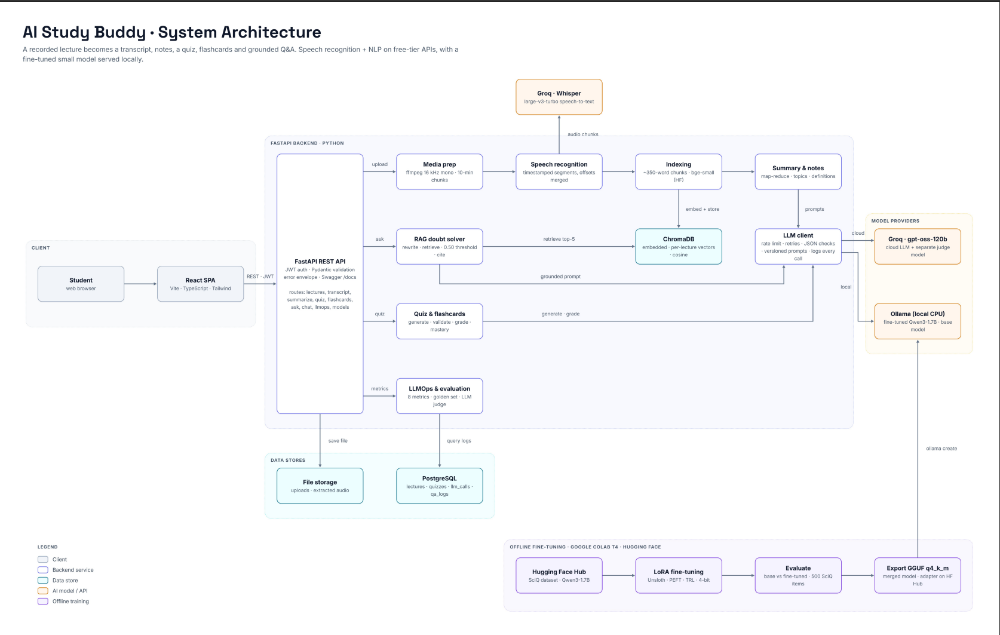
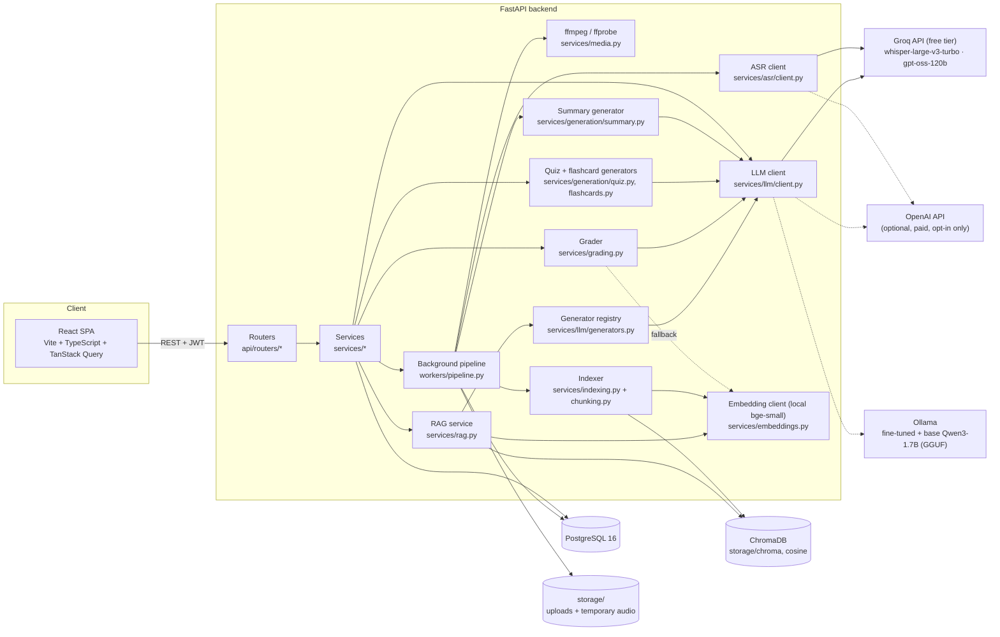
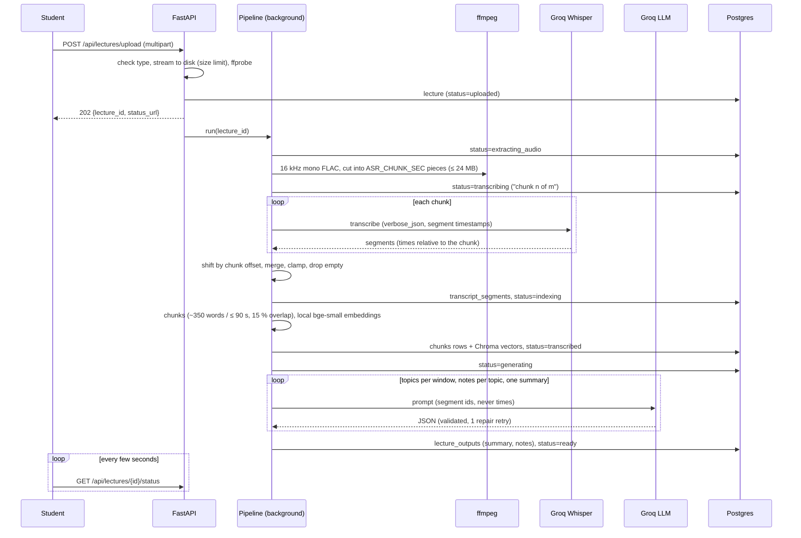
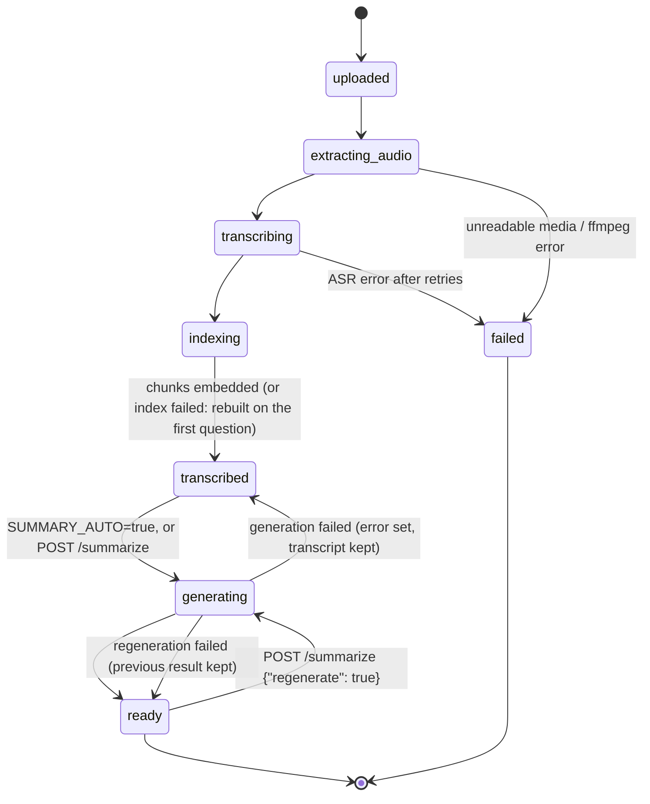
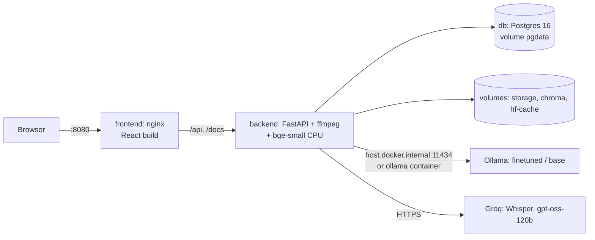
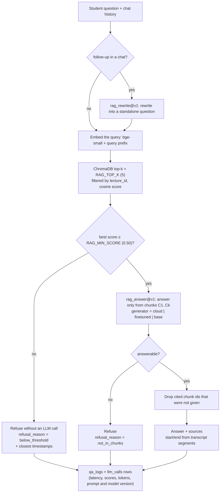

# Architecture

This page describes the finished app: the React frontend, the FastAPI backend (upload, transcription, search indexing, summary and notes, quizzes with grading and mastery, flashcards, grounded Q&A and chat), the fine-tuned SLM served through Ollama, the LLMOps metrics and evaluation harness ([llmops.md](llmops.md)) and the Docker deployment ([deployment.md](deployment.md)). Phase 9 (mind map, adaptive learning) was not built; see §12. The full design and phase plan live in [IMPLEMENTATION_PLAN.md](../IMPLEMENTATION_PLAN.md).



*Figure: system architecture, exported from the team's design canvas to `docs/images/architecture.png`. The Mermaid diagrams below show the same structure in more detail.*

## 1. System overview



Dashed arrows are used only when you configure them explicitly. The app **never switches provider on its own**: when Groq rate-limits or a model is unavailable, the request fails with a clear error (`429 RATE_LIMITED`, `503 MODEL_UNAVAILABLE`) instead of falling back to a paid API.

## 2. Backend layers

| Layer | Folder | Responsibility |
|---|---|---|
| Routers | `app/api/routers/` | HTTP only: parse and validate input, call a service, shape the response. No business logic. |
| Dependencies | `app/api/deps.py` | DB session, settings, current user (JWT), storage, ffmpeg wrapper, pipeline, generator. Tests override these. |
| Schemas | `app/schemas/` | Pydantic request/response models (shown in Swagger). |
| Services | `app/services/` | Business logic: `auth`, `lectures`, `summaries`, `quizzes`, `grading`, `flashcards`, `embeddings`, `chunking`, `indexing`, `vectorstore`, `rag`, `chat`, `storage`, `media`, `transcript_format`, `asr/`, `llm/`, `generation/` (summary, quiz, flashcards, shared transcript batches in `context.py`). |
| Worker | `app/workers/pipeline.py` | The lecture pipeline, run by FastAPI `BackgroundTasks`. |
| Models | `app/models/` | SQLAlchemy 2 tables; migrations in `alembic/versions/`. |
| Core | `app/core/` | Settings (`config.py`), error envelope, structlog logging, request-id middleware, password hashing and JWT. |
| Prompts | `app/prompts/*.yaml` | Versioned prompt templates (`id`, `version`). |

Every error, from any layer, is returned as `{"error": {"code", "message", "details"}}`.

## 3. Lecture pipeline



Each stage writes a `pipeline_runs` row (start, end, duration, audio seconds), and every request to a model writes an `llm_calls` row (see §5).

### Status values



- `transcribed` with a non-null `error` means the transcript is available but the summary failed. Retry with `POST /api/lectures/{id}/summarize`.
- On startup, lectures left in `uploaded`, `extracting_audio` or `transcribing` by a restart are marked `failed` (background tasks cannot resume). Lectures left in `generating` go back to `transcribed`.
- `indexing` comes between transcription and `transcribed`. A lecture left in `indexing` by a restart goes back to `transcribed`, and the first question re-indexes it. See [rag.md](rag.md).

## 4. Grounding rules (how the app avoids invented content)

1. **Timestamps come only from ASR segments.** Whisper returns segment start/end times per chunk; the pipeline adds the chunk's offset. A provider that returns text without segments is rejected rather than given made-up times.
2. **The LLM never writes times.** Prompts show the transcript as `[segment id] text` lines and ask for segment ids. The app converts ids to times by looking up the stored segments; ids outside the window are clamped to it, and a definition with an invalid id gets `timestamp: null`.
3. **Only the transcript is used.** Each prompt tells the model to use only the transcript, add no outside knowledge, and write `(not stated in lecture)` where the lecturer left something incomplete.
4. **Prompts are versioned.** Every call logs `prompt_id@version`, so results can be traced to the exact prompt.
5. **Quiz questions and flashcards are checked by the app.** Their topic and timestamp come from the segment id the model cites. An item that cites a segment outside its batch, or fails any other check, is discarded: questions are regenerated, while cards are just dropped.

Details: [summarization.md](summarization.md) and [quizzes.md](quizzes.md).

## 5. Model calls and LLMOps logging

All model calls go through three wrappers. No other code calls an SDK or model directly.

| Wrapper | Used for | Providers |
|---|---|---|
| `services/llm/client.py` → `LLMClient.complete()` | topics, notes, summary, quiz, short-answer grading, flashcards, RAG answer and follow-up rewrite, evaluation judge | `groq` (default), `openai` (opt-in), `ollama` (fine-tuned and base SLM) |
| `services/asr/client.py` → `ASRClient.transcribe_chunk()` | speech-to-text | `groq` (default), `openai` (opt-in), `local` (faster-whisper, optional) |
| `services/embeddings.py` → `EmbeddingClient.embed()` / `embed_queries()` | chunk indexing, search queries (with bge's prefix), short-answer grading fallback | `local` (sentence-transformers, loaded on first use) |

Answer generators for `/ask` and `/chat` (`cloud`, `finetuned`, `base`, plus any added via `ANSWER_GENERATORS`) are entries in `services/llm/generators.py`. Each one is the same `LLMClient` with a fixed provider and model, so its calls are logged like every other call.

What the LLM client does for each request:

1. Renders the YAML prompt; adds the JSON Schema to the system prompt when structured output is required.
2. Picks the provider: an explicit argument, else `LLM_PROVIDER`. It never falls back to another provider.
3. **Paces Groq requests** to stay under the free tier's tokens-per-minute limit (`GROQ_TOKENS_PER_MINUTE`, see `services/llm/ratelimit.py`), and sends `reasoning_effort` (`LLM_REASONING_EFFORT`) to Groq/OpenAI reasoning models.
4. Sends the request; on 429 or an outage it retries the same provider with exponential backoff, honouring `Retry-After` (`LLM_MAX_RETRIES`, `LLM_BACKOFF_*`).
5. Validates JSON with Pydantic; if invalid, makes one repair request showing the model its errors.
6. Writes one `llm_calls` row per request sent: task, provider, model, model version, prompt version, attempt, tokens, latency, cost, status, error type.

**Model versions (Phase 11).** `llm_calls.model_version` is the model string the provider returned. For Ollama it is extended with the local model's digest (`study-buddy-qwen@sha256:…`, from `GET /api/tags`, cached for 5 minutes; a failed lookup never fails the request). Embedding calls store `BAAI/bge-small-en-v1.5@<Hugging Face commit>`. Groq's speech-to-text response has no model field, so ASR rows keep `null`. `reasoning_effort` is sent only to reasoning models (gpt-oss, gpt-5, o-series).

The LLMOps dashboard (`/api/llmops/*`, page **LLMOps**) computes every metric from these rows at request time: [llmops.md](llmops.md).

Cost comes from `backend/config/pricing.yaml`: `free_tier` and `local` providers record `0.0`; paid providers multiply real token counts (or audio minutes for ASR) by the listed price. An unknown paid model records `null`, never a guess.

## 6. Data stored

| Table | Written by | Contents |
|---|---|---|
| `users` | auth | e-mail, bcrypt hash |
| `lectures` | upload, pipeline | title, file info, duration, language, status, progress, stage detail, error |
| `transcript_segments` | pipeline | `idx`, `start_sec`, `end_sec`, `text` (merged, continuous timeline) |
| `lecture_outputs` | summaries service | `kind=summary` and `kind=notes` JSON, prompt version, model (the cache for `/summarize`) |
| `quizzes`, `quiz_questions` | quizzes service | request settings + generation meta; questions with answer, explanation, rubric (key points), `source_start` |
| `quiz_attempts`, `attempt_answers` | quizzes service | score/percent per submission; per question: response, correct, score, `graded_by`, feedback |
| `topic_mastery` | quizzes service | per user + lecture + topic: moving-average mastery and question count |
| `flashcards` | flashcards service | front, back, kind (definition/concept), topic, `source_start`, Leitner box, `due_at` |
| `chunks` | indexer | retrieval chunks: `idx`, `start_sec`, `end_sec`, `text`, `vector_id` (vectors in Chroma) |
| `chat_sessions`, `chat_messages` | chat service | conversation turns; answers keep their sources, `answerable` and generator |
| `qa_logs` | chat service | one row per question: generator, scores, threshold, refusal reason, retrieval and end-to-end latency |
| `llm_calls` | LLM, ASR and embedding clients | one row per model request (kept when a lecture is deleted: `lecture_id` set to NULL) |
| `pipeline_runs` | pipeline | one row per stage with duration and audio seconds |
| `eval_runs`, `eval_items` | eval harness (`python -m eval.run`), offline import | Phase 11: one run per generator (+ one retrieval run) per golden set, per-question results; Phase 10 SciQ files imported as `source=offline_import`. See [llmops.md](llmops.md) |

Files on disk (`STORAGE_DIR`, gitignored):

```
storage/
├── uploads/<lecture_id>/original.<ext>   the uploaded file (kept until the lecture is deleted)
└── audio/<lecture_id>/chunk_NNN.flac      temporary; deleted when the pipeline finishes
```

## 7. Configuration

All settings are read by `app/core/config.py` from environment variables or the repo-root `.env`; every variable is listed with a comment in [`.env.example`](../.env.example). The ones that shape the pipeline:

| Setting | Default | Effect |
|---|---|---|
| `ASR_PROVIDER` / `LLM_PROVIDER` | `groq` | Free tier by default; `openai` only when set explicitly |
| `ASR_CHUNK_SEC`, `ASR_MAX_CHUNK_MB` | 600, 24 | Audio piece length and size cap (Groq accepts ≤ 25 MB) |
| `SUMMARY_AUTO` | `true` | Generate summary + notes right after transcription |
| `SUMMARY_SINGLE_PASS_MAX_TOKENS` | 3500 | Above this, map-reduce over windows |
| `SUMMARY_WINDOW_SEC`, `SUMMARY_WINDOW_MAX_TOKENS` | 600, 2500 | Window size for map-reduce |
| `GROQ_TOKENS_PER_MINUTE` | 8000 | Client-side pacing; 0 turns it off |
| `LLM_REASONING_EFFORT` | `low` | Fewer hidden reasoning tokens on gpt-oss |
| `QUIZ_CONTEXT_MAX_TOKENS`, `QUIZ_MAX_REGEN_ROUNDS` | 2500, 2 | Transcript per quiz/flashcard request; retries for invalid questions |
| `SHORT_ANSWER_SIM_THRESHOLD` | 0.85 | Embedding-fallback bar for a correct short answer |
| `MASTERY_EMA_ALPHA`, `MASTERY_WEAK_THRESHOLD` | 0.3, 0.6 | Mastery moving average; weak-topic cut-off |
| `CHUNK_TARGET_WORDS`, `CHUNK_MAX_SEC`, `CHUNK_OVERLAP` | 350, 90, 0.15 | Retrieval chunk size and overlap |
| `RAG_TOP_K`, `RAG_MIN_SCORE` | 5, 0.50 | Chunks per question; refusal threshold (first filter; judgement call from the calibration, see [rag.md](rag.md#3-calibrating-rag_min_score)) |
| `ANSWER_GENERATORS` | `{}` | Extra answer generators, added by configuration only |
| `EVAL_JUDGE_PROVIDER`, `EVAL_JUDGE_MODEL` | `groq`, `qwen/qwen3.8-27b` | LLM-as-judge of the eval harness (Phase 11); deliberately not the cloud generator's model |
| `FINETUNE_RESULTS_DIR`, `FINETUNED_HUB_REPO` | `../finetune/results`, blank | Where the model registry reads `training.json`; the Hub repo shown next to it |

## 8. Testing approach

- `pytest` runs on in-memory SQLite with fake providers (`tests/fakes.py`): `FakeASRProvider` for speech, `FakeLectureLLM` for the topics/notes/summary/quiz/grading/flashcard prompts (it can inject invalid quiz items to test regeneration), and `FakeEmbedder` (bag-of-words vectors, so the embedding model is never downloaded in tests). The vector store is a real in-memory Chroma with a new collection per test (telemetry off). An autouse fixture fails any test that opens a non-loopback network connection.
- Media tests generate short tones and tiny videos with ffmpeg (`tests/fixtures/audio.py`) and are skipped if ffmpeg is not installed.
- Real-provider checks are manual: `scripts/llm_smoke.py`, `scripts/embedding_smoke.py`, `scripts/manual_phase4.*`, `scripts/manual_phase5.*`, `scripts/manual_phase6.*`, `scripts/manual_phase7.*`, `scripts/calibrate_rag.py`.
- `tests/test_docker_config.py` checks the compose file, Dockerfiles and nginx config without Docker (skipped inside the backend image, which has no compose file).

## 9. Deployment (Phase 12)



`docker compose up --build` starts `db` → `backend` (runs `alembic upgrade head`, then uvicorn as a non-root user)
→ `frontend` (nginx serves the SPA and proxies `/api`, re-resolving the backend's name so a recreated backend is
found). Each waits for the previous one's healthcheck. Compose overrides only the container paths and hosts; every
other setting comes from `.env`. Details, the Ollama profile and the VM guide: [deployment.md](deployment.md).

## 10. Frontend

A React 18 single-page app (`frontend/`), built with Vite and TypeScript and styled with Tailwind CSS and shadcn/ui.

| Part | Folder | Responsibility |
|---|---|---|
| API client | `src/api/client.ts`, `endpoints.ts`, `types.ts` | One HTTP client: adds the Bearer token, turns the error envelope into a typed `ApiError`, handles 401 (log out once), downloads and upload progress. `endpoints.ts` has one typed function per backend endpoint; `types.ts` mirrors the backend's Pydantic schemas |
| Data fetching | `src/api/hooks.ts` (TanStack Query) | Caching, polling of `/status` while a lecture is processing, invalidation after mutations |
| Routing | `src/routes.tsx` | React Router; pages are lazy-loaded; logged-out visitors go to `/login` |
| Pages | `src/pages/` | Login / Register, Dashboard, Upload, Processing, the lecture workspace (Transcript, Summary & Notes, Quiz, Ask, Flashcards, Mind map placeholder), Analytics, LLMOps |
| Helpers | `src/lib/` | Formatting, transcript search, quiz/chat helpers, LLMOps chart rows (all unit-tested) |

Charts use Recharts. The Dashboard and Analytics pages compute their figures from the existing lecture, quiz and
flashcard endpoints (no separate dashboard API). No page uses mock data; the tests use mocked API responses only
([testing.md](testing.md)).

## 11. Q&A (RAG) flow



Two layers decide whether to answer: the similarity threshold refuses clearly unrelated questions cheaply, and the
answer prompt refuses questions from the same field that the lecture doesn't cover. The threshold was calibrated in
Phase 7 and re-checked on the golden set in Phase 11 ([rag.md](rag.md#3-calibrating-rag_min_score)).

## 12. Not built (Phase 9, future work)

Phase 9 was skipped. The following parts of the original design are therefore **not** in the app: the mind map
(`POST /lectures/{id}/mindmap`; the tab shows a "planned" placeholder), adaptive quiz difficulty
(`adaptive: true` returns `422 ADAPTIVE_NOT_AVAILABLE`), revision recommendations, `GET /lectures/{id}/progress`
and `GET /dashboard/overview`. Topic mastery is already stored (`topic_mastery`), so these features can build on it.
