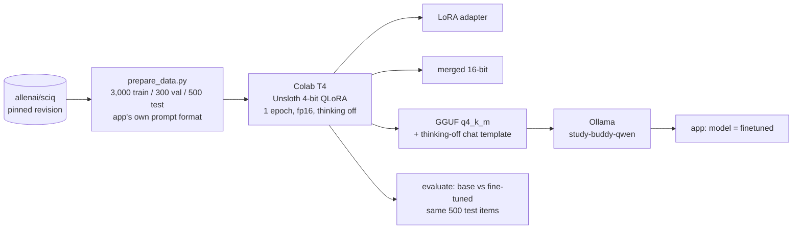
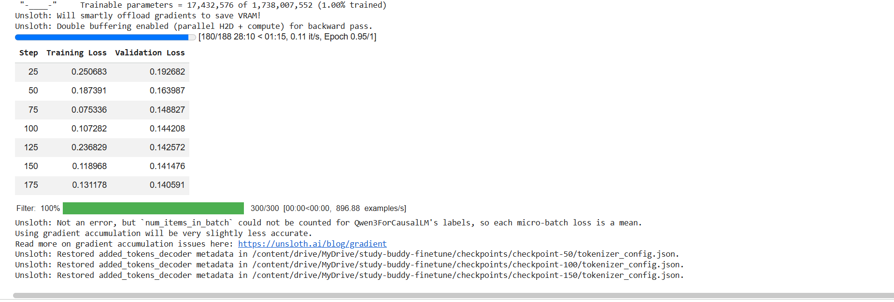

# Fine-tuned answer model: Qwen3-1.7B on SciQ (Phase 10)

This page explains how the app's **"finetuned"** answer generator was built and what the base-vs-fine-tuned
comparison shows. How to run it yourself: [finetune/README.md](../finetune/README.md). The full model card:
[finetune/MODEL_CARD.md](../finetune/MODEL_CARD.md). The weights are on the Hugging Face Hub at
[huggingface.co/TusharDecoded/study-buddy-qwen3-1.7b-sciq-lora](https://huggingface.co/TusharDecoded/study-buddy-qwen3-1.7b-sciq-lora)
(**private**: LoRA adapter, GGUF q4_k_m and the model card).

> Every number on this page is copied from a file in `finetune/results/`, named next to it.

## 1. Pipeline

- **Format:** the model is trained on exactly what the app sends: the `rag_answer@v1` prompt with its JSON schema,
  excerpts labelled `[C1]…[Ck]`, and the JSON answer `{answerable, answer, citations}`. `finetune/tests` fails if the
  copy in `finetune/prompts.py` drifts from the app's prompt.
- **Mix:** 2,250 grounded QA / 450 refusal / 300 MCQ-generation examples (`data_stats.json` → `splits.train.by_task`).
  Answers and support sentences come from SciQ, never from a model.
- **Thinking off:** Ollama renders Qwen3 with the chat template stored in the GGUF and ignores a Modelfile `TEMPLATE`.
  So `set_chat_template.py` embeds a template that always adds the empty think block, which is the exact training prompt.
- **Serving:** no backend change was needed. `FINETUNED_MODEL_TAG=study-buddy-qwen` and
  `BASE_SLM_MODEL_TAG=study-buddy-qwen-base` point the existing `finetuned` and `base` generators at Ollama.

## 2. Training

Source: `results/training.json` (Tesla T4, 188 steps, versions recorded under `versions`).

- Validation loss fell from 0.1927 (step 25) to 0.1405 (step 188), and was still falling slightly at the end, with no sign of overfitting.
- **Training time ≈ 30.2 min, reconstructed (at least 28.9 min)** (`results/training_time_reconstructed.json`).
  - **What happened:** the notebook's own measurement was overwritten. Step 6 was re-run in a new session after
    training had finished, resumed from the final checkpoint, trained 0 steps, and saved that session's time.
  - **How it was rebuilt:** from the original run's progress bar `[180/188 28:10 < 01:15, 0.11 it/s]` plus the
    logged step-188 evaluation. `trainer_state.json` has no wall-clock times, so it can't be used.
    Source screenshot (it also shows the loss table): [screenshots/training_progress.png](screenshots/training_progress.png)

    
  - **Since then:** the notebook appends every training session to `results/training_sessions.jsonl` and sums them,
    so a re-run can't erase the time again.

## 3. Results: base vs fine-tuned

Same 500 SciQ test items, same prompts, greedy decoding, thinking off. Base = adapter off, fine-tuned = adapter on,
on the same 4-bit weights (Colab T4). Source: `results/eval_hf.json`.

| | Base | Fine-tuned |
|---|---|---|
| Grounded-QA accuracy (n = 375) | 0.7227 | **0.9093** |
| Token F1 / ROUGE-L | 0.3535 / 0.3378 | **0.8339 / 0.8299** |
| Cites the right excerpt | 0.8613 | **0.984** |
| Refusal precision / recall (n = 75 should refuse) | 0.4737 / 0.84 | **0.9221 / 0.9467** |
| Answerable questions wrongly refused (fp) | 70 | **6** |
| RAG JSON validity | 1.0 | 1.0 |
| MCQ JSON validity (n = 50) | **0.9** | 0.82 |
| MCQ answer matches source (primary, strict) | 0.08 | **0.22** |
| Latency per answer, GPU mean / p95 (ms) | **624.7 / 893.1** | 816.0 / 1,119.5 |
| Latency through Ollama on CPU, **50-item subset** (mean / p95 ms) | 9,765.4 / 14,385.8 | 9,877.2 / 15,115.7 |

### What improved

The fine-tuned model:
- answers in the app's format, with the support sentence and a citation, so token F1 and ROUGE-L more than double;
- is more often right and cites the right excerpt;
- refuses far more precisely. The base model refused 70 answerable questions; the fine-tuned model refuses 6.

### What got worse, and why (likely causes)

**MCQ JSON validity, 0.9 → 0.82.**
- All 9 invalid fine-tuned MCQs are valid JSON with **four identical options**. The base model's 5 failures are broken JSON.
  Source: `results/mcq_secondary_hf.json` → `invalid_reasons`.
- MCQ was only 10 % of the training mix. The model copied SciQ's short-option style but sometimes repeats the correct
  answer instead of writing distractors.
- The app's quizzes don't use this model: they come from the cloud model, with validation and regeneration.

**GPU latency, mean 624.7 → 816.0 ms.**
- **Likely cause:** the evaluation setup. The fine-tuned pass computes the separate (unmerged) LoRA adapter at every
  token; the base pass has it switched off.
- **Output length doesn't explain it.** Answers are a little longer (mean 36.2 → 41.6 tokens), but the mean longest
  output per batch of 8, which sets the batch time, is about the same (64.5 vs 62.1 tokens).
  Source: `results/output_stats_hf.json`.
- The served GGUF has the adapter merged in. Through Ollama on CPU (50-item subset, `results/eval_ollama_subset50.json`),
  the two models are about 1 % apart (mean 9,765.4 vs 9,877.2 ms), which supports the adapter explanation.
  Caveats: only 50 items, and the base GGUF comes from Ollama's `qwen3:1.7b`, quantised separately from the fine-tuned one.
- In the app, this means an answer from the local models takes about 10 s on this CPU (mean of the subset run).
  The machine is recorded in the results file (`machine`, `processor`).

### MCQ secondary checks (added after the first results)

The strict primary metric requires the marked option to equal SciQ's answer, but the model may ask about another fact
or word the answer differently. Two looser checks were added **after seeing the first results**. They are re-scored
from the saved predictions by `finetune/rescore_mcq.py`, with no new generations, and are secondary only.
Source: `results/mcq_secondary_hf.json`.

| | Base | Fine-tuned |
|---|---|---|
| Loose match (contains / is contained in SciQ's answer) | 0.12 | 0.28 |
| Marked option appears word for word in the passage | 0.26 | 0.7 |

## 4. Limits

- **Domain:** trained and tested on SciQ science passages, not lecture transcripts. Transfer to real lectures is
  measured in Phase 11 (golden set): TBD (run Phase 11).
- **Length:** trained on prompts of at most 1,024 tokens. The app's prompts with 5 chunks can be longer
  (`num_ctx 4096` in the Modelfile).
- **Licence:** SciQ is CC-BY-NC-3.0, so the model is for non-commercial use.
- **Comparison scope:** the GPU comparison uses the 4-bit training weights. The Ollama models are separately quantised
  GGUFs: the base comes from Ollama's `qwen3:1.7b`, and the fine-tuned one from the merged model.
