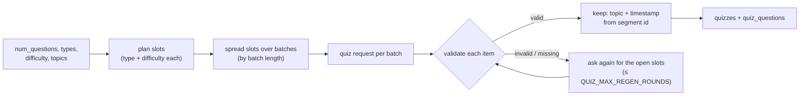

# Quizzes, grading, mastery and flashcards (Phase 6)

This page explains how quiz questions and flashcards are generated from a lecture, how answers are graded, and how topic mastery is tracked. The endpoints are listed in [api.md](api.md#quizzes). For the summary and topic notes these features build on, see [summarization.md](summarization.md).

Both features need the lecture's **topic notes** (Phase 5). A quiz question or card is tagged with the topic that contains its transcript segment, and per-topic mastery is built from those tags.

## 1. Transcript batches

The model never sees the whole lecture at once. Groq's free tier allows about 8K tokens per minute, so the lecture is cut into **batches** (`services/generation/context.py`):

1. Each topic from the notes is a range of segment ids. A topic longer than `QUIZ_CONTEXT_MAX_TOKENS` (2500) is split into parts.
2. Consecutive topics and parts are packed into batches that stay under the same cap.
3. Every request gets one batch, shown as `[segment id] text` lines.

A short lecture is a single batch. For example, the 5-minute test lecture needed one quiz request and one flashcard request.

## 2. Quiz generation



- **Slots.** The app plans every question up front, for example `slot 1: mcq, easy`. Types rotate through the requested list. With `difficulty: "mixed"`, levels cycle easy → medium → hard. Each question's difficulty comes from its slot, not from the model.
- **Allocation.** Slots are spread across batches in proportion to their length. When there are fewer questions than batches, they are spaced evenly across the lecture.
- **Validation** (`validate_item` in `services/generation/quiz.py`). Any failure discards the item, and its slot is requested again:

  | Rule | Reason code |
  |---|---|
  | The slot was requested and is still open | `unknown_or_filled_slot` |
  | The type matches the slot | `wrong_type` |
  | The question and explanation are not empty | `empty_question`, `empty_explanation` |
  | The question is not a duplicate (ignoring case and punctuation) | `duplicate_question` |
  | MCQ: exactly 4 options | `mcq_not_4_options` |
  | MCQ: the 4 options are unique | `mcq_duplicate_options` |
  | MCQ: the answer is one of the options (by text or letter) | `mcq_answer_not_in_options` |
  | True/false: the answer is a boolean | `true_false_answer_not_boolean` |
  | Short answer: there is a model answer | `short_answer_empty_answer` |
  | `segment_id` is a real segment inside the batch | `segment_out_of_range` |

- **Regeneration.** Only the open slots are requested again, together with the questions already accepted under "Already asked", so the model doesn't repeat them. If slots are still open after `QUIZ_MAX_REGEN_ROUNDS` extra requests, the quiz is saved with fewer questions: `meta.generated` < `meta.requested`, and `meta.invalid_reasons` says why. If no valid question comes back at all, the response is `502 QUIZ_GENERATION_FAILED`.
- **MCQ options are shuffled by the app**, so the correct answer isn't always in the model's favourite position. The stored answer is the letter A–D.
- **Grounding.** The topic and `timestamp` of a question come from its segment id, looked up in the stored notes and transcript. The model is told to use only the transcript.
- **Hidden answers.** `POST /generate-quiz` and `GET /quizzes/{id}` return no answers or explanations. Those come back only from `/submit`.

`adaptive: true` returns `422 ADAPTIVE_NOT_AVAILABLE` until Phase 9.

## 3. Grading

| Question type | How it is graded | `graded_by` |
|---|---|---|
| mcq | Letter (`B`, `b`, `B)`) or exact option text, compared with the stored answer | `rule` |
| true_false | `true` / `false` (JSON boolean or string) | `rule` |
| short_answer | **One** LLM request (`JUDGE_MODEL`, prompt `grade_short@v1`) grades all short answers against the reference answer and key points. Score = fraction of key points covered; correct when the essential idea is there | `llm` |
| short_answer, LLM failed | Cosine similarity of the answer and the reference answer, using the local embedding model. ≥ `SHORT_ANSWER_SIM_THRESHOLD` counts as correct | `embedding` |
| empty / missing answer | Wrong, with no model call | `rule` |

- **When the fallback applies.** It is used when the grading request fails (rate limit after retries, model unavailable, invalid JSON twice) or skips an item. It runs on your machine, so it never switches to another (paid) LLM provider. If the embedding model fails too, the response is `503 GRADING_UNAVAILABLE`, and the app never marks answers wrong by default.
- **Embedding model.** This is `BAAI/bge-small-en-v1.5` through `services/embeddings.py`. It loads on the first fallback, not at startup. The first time also downloads about 130 MB into the Hugging Face cache. It stays in memory for the rest of the process, and every call writes an `llm_calls` row (`provider=local`, cost 0). The one-time load is logged separately (`embedding_model_loaded`) and is not counted in the row's latency. Phase 7 reuses the same wrapper for RAG.
- **Threshold.** bge-small rates even unrelated sentences quite similar, which is why the default threshold is a high 0.85. In the smoke run below, unrelated sentences scored about 0.76 against the reference and correct paraphrases about 0.95. That was 4 sentences, not a tuning run, so check it on your own data with `python -m scripts.embedding_smoke`. The threshold is due for tuning together with the other evaluation settings in Phase 11.

Each submission stores a `quiz_attempts` row and one `attempt_answers` row per question (response, correct, score, `graded_by`, feedback).

## 4. Topic mastery

`topic_mastery` holds one row per user, lecture and topic. For each topic in a submitted attempt:

```
result  = mean score of that topic's questions in this attempt   (0..1; short answers can be partial)
first   : mastery = result
later   : mastery = MASTERY_EMA_ALPHA × result + (1 − MASTERY_EMA_ALPHA) × mastery    (alpha = 0.3)
attempts += number of questions on that topic
```

- **`weak_topics`:** topics with mastery below `MASTERY_WEAK_THRESHOLD` (0.6), weakest first.
- **`suggested_next_difficulty`:** from the attempt's percentage. Below 50 % suggests easy, 50–80 % medium, above 80 % hard (the same thresholds Phase 9 uses for mastery).

## 5. Flashcards

A deck is generated once per user and lecture (`POST /lectures/{id}/flashcards`). Calling it again returns the stored deck. `regenerate: true` replaces the deck and resets its review progress.

| Kind | Source | LLM call? |
|---|---|---|
| `definition` | Each definition in the Phase 5 summary: term → definition, with the timestamp already looked up from the transcript | No |
| `concept` | Prompt `flashcards@v1`, batch by batch: one idea per card, question on the front, 1–3 sentence answer on the back, plus a `segment_id` | Yes |

- **No duplicates.** Each front is reduced to a key: lower case, no punctuation, with question words such as "what is" or "define" and articles removed. So "What is a Neuron?" and "neuron" match. A card whose key matches an earlier card or a definition term is dropped. The model is also told which terms already have a definition card.
- **No guessed timestamps.** A concept card whose segment id is outside its batch is dropped. A definition whose segment was invalid in Phase 5 keeps `timestamp: null`.
- **Deck size.** At most `FLASHCARDS_MAX_CARDS` (30). Definition cards come first, and the rest are concept cards spread over the batches.
- **Dropped cards.** `meta.dropped` counts the cards removed by each rule.

### Leitner review

`POST /flashcards/{card_id}/review` with `{"knew": true|false}`:

| | Box 1 | Box 2 | Box 3 | Box 4 | Box 5 |
|---|---|---|---|---|---|
| Next review after | now | 1 day | 3 days | 7 days | 14 days |

- **Knew it:** the card moves up one box (at most 5).
- **Didn't know:** the card goes back to box 1 and is due again immediately, so it comes back in the same session.
- **New cards:** they start in box 1 and are due now.
- **Due cards:** `GET /lectures/{id}/flashcards?due=true` lists the cards due now.

## 6. LLMOps

Every request writes an `llm_calls` row. The task values are `quiz`, `grading`, `flashcards`, `grading_embedding` and `embedding_smoke`. The `meta` objects in the responses (calls, tokens, latency, rejected items) are the real counts from that run. M3 (quiz generation latency) in [IMPLEMENTATION_PLAN §7.2](../IMPLEMENTATION_PLAN.md#72-metrics-8-at-least-5-required) is computed from the `task = quiz` rows.
