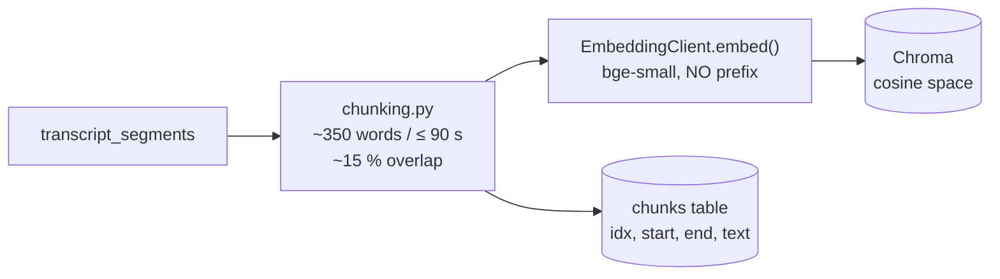
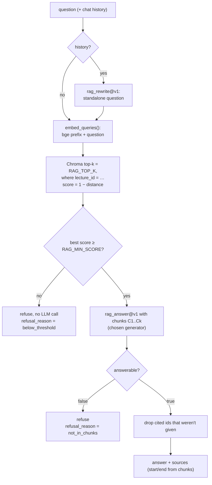

# Grounded Q&A: retrieval, refusals and chat (Phase 7)

This page explains how the doubt solver answers questions about a lecture **only from its transcript**, when it refuses, and how the refusal threshold was calibrated. Endpoints: [api.md](api.md#ask-and-chat).

## 1. Indexing

- **When:** the pipeline indexes right after transcription (status `indexing`). A lecture transcribed before Phase 7, or whose vectors are missing, is indexed on its **first question** (`meta.indexed_now: true`). If indexing fails in the pipeline, the summary still runs and the first question tries again.
- **Chunks:** consecutive transcript segments, about `CHUNK_TARGET_WORDS` (350) words and at most `CHUNK_MAX_SEC` (90 s), with about `CHUNK_OVERLAP` (15 %) of each chunk repeated at the start of the next one. Segments are never split, so a chunk's `start`/`end` are real segment times.
- **Embeddings:** the Phase 6 `EmbeddingClient` (`BAAI/bge-small-en-v1.5`, local, free, loaded on first use). Stored chunks are embedded **without** a prefix.
- **Vector store:** ChromaDB on disk at `CHROMA_DIR`, one collection per environment (`lecture_chunks_development`). The collection is created with `{"hnsw:space": "cosine"}`, and every item carries `lecture_id` metadata. The app passes its own vectors (`embedding_function=None`), so Chroma downloads no model, and telemetry is off.
- **Deleting a lecture** removes its vectors too.

## 2. Answering a question

1. **Query prefix.** bge models are trained to compare a *query* that starts with "Represent this sentence for searching relevant passages: " against *plain* passages. `EmbeddingClient.embed_queries()` adds `EMBEDDING_QUERY_PREFIX` to search questions only. Stored chunks never get it.
2. **Score.** Chroma returns the cosine distance, and the app reports `score = 1 − distance`, which for normalised vectors is the cosine similarity.
3. **Threshold as a first filter.** If the best score is below `RAG_MIN_SCORE`, the app answers "This isn't covered in the lecture." with the closest timestamps, and **no LLM is called**.
4. **The answer prompt is the second filter.** The chunks are labelled `C1…Ck`, and the model is told to answer only from them and to set `answerable: false` when they don't contain the answer. Above the threshold, the model can therefore still refuse (`refusal_reason: not_in_chunks`).
5. **Citation check.** Cited ids that weren't provided are dropped and also removed from the answer text (`meta.citations_dropped`). If no valid citation is left, every chunk the model saw is returned as a source (`meta.citation_check: none_valid`).
6. **Timestamps.** Each source's `start`/`end` come from its chunk, which means from the ASR segments. The model is never shown, or asked for, a time.

A refusal returns up to 3 closest chunks with `cited: false`, so a student can still jump to the nearest part of the lecture.

## 3. Calibrating `RAG_MIN_SCORE`

`python -m scripts.calibrate_rag --lecture-id <id>` runs on-topic and off-topic questions from `backend/eval/calibration/demo_lecture_questions.json` against one lecture:
- It embeds every question exactly as `/ask` does and prints the best score per question and the distribution per group.
- It proposes a threshold from those scores: the midpoint of the gap when the groups don't overlap, otherwise the value with the best balanced accuracy.
- It makes no LLM calls, and it saves the JSON to `storage/manual-test/`.

**Real run, 2026-11-07, demo lecture "Scalable recording" (4:51, 4 chunks), bge-small-en-v1.5, top-k 5:**

| Group | n | min | median | max |
|---|---|---|---|---|
| on-topic | 10 | 0.580 | 0.753 | 0.788 |
| off-topic | 10 | 0.304 | 0.487 | 0.566 |

- **Hardest cases:** the lowest on-topic question was "What is Function as a Service?" (0.580). The highest off-topic ones were near-domain computer-science questions: TCP vs UDP (0.566), database indexes (0.557), Java garbage collection (0.543).
- **Proposal:** the script proposed **0.573**, the midpoint of a gap of only 0.013.
- **The earlier default:** at 0.35, 9 of the 10 off-topic questions passed the threshold.

**Interpretation.** bge-small separates clearly unrelated questions (the World Cup scored 0.30) from the lecture's own topics (0.58 and up). Questions from the *same field* that the lecture doesn't cover score almost as high as real ones, so a threshold alone can't reject them safely. That is why the answer prompt can still refuse. In the live run, "What is the difference between TCP and UDP?" (0.566) passed the 0.35 threshold and was refused by the model with `not_in_chunks`.

**Chosen default: `RAG_MIN_SCORE = 0.50`.** This is a *judgement call* based on the calibration, not the script's fitted value.
- **Why not 0.573:** it sits in a gap of only 0.013. A slightly harder on-topic question than "What is Function as a Service?" (0.580, the on-topic minimum) would be refused without ever reaching the model.
- **Why 0.50:** it keeps a 0.08 margin below the on-topic minimum (0.580) and sits just above the off-topic median (0.487). Clearly unrelated questions (the World Cup at 0.304, the French Revolution at 0.373, sourdough at 0.439, photosynthesis at 0.494) are therefore refused at once, with no LLM call. Near-domain questions such as TCP vs UDP (0.566) or database indexes (0.557) pass the threshold and are left to the answer prompt, which refused TCP vs UDP in the live run.
- **On this question set at 0.50:** 0 of 10 on-topic questions would be refused, and 4 of 10 off-topic questions (TCP vs UDP, database indexes, Java garbage collection, quicksort) would pass the threshold for the model to judge.

It is based on 20 questions from one 5-minute lecture, so it must be **re-checked with the golden set in Phase 11**. Override it per deployment with `RAG_MIN_SCORE` in `.env`.

**Phase 11 re-check (golden set `ci_lecture`, 2026-11-09, [llmops_results.md](llmops_results.md) §8).** Top scores:
on-topic 0.620–0.760 (12 questions), near-topic 0.598–0.624 (4), off-topic 0.362–0.519 (4). At 0.50, no answerable
question is refused by the threshold; 3 of 4 off-topic questions are refused without an LLM call; all near-topic
questions and one off-topic question (0.519) go to the model. The highest near-topic score is above the lowest
on-topic score (gap −0.004), so no threshold alone separates them, which confirms the two-layer design. **0.50 is
kept**; the result was reported to the team, and the value is not changed by the evaluation.

## 4. Chat

- **Turns:** `POST /lectures/{id}/chat` without `session_id` starts a session. Each turn stores the user message and the answer, with its sources, in `chat_messages`.
- **Follow-ups:** a later message is first rewritten into a standalone question by `rag_rewrite@v1` (generator `RAG_REWRITE_GENERATOR`, default `cloud`), using the last `RAG_HISTORY_TURNS` question/answer pairs. Retrieval and the answer then use only that standalone question and the chunks, so earlier answers can't leak unsupported claims into the new one.
- **History:** `GET /lectures/{id}/chat/{session_id}` returns the conversation, and `GET /lectures/{id}/chat` lists the sessions.

## 5. Answer generators

`model` in `/ask` and `/chat` names an entry in the generator registry (`services/llm/generators.py`). Every entry is name → (LLM client, provider, model):

| Name | Provider / model | Notes |
|---|---|---|
| `cloud` (default) | `LLM_PROVIDER` / `LLM_MODEL` (Groq `gpt-oss-120b`, free tier) | Retries as `LLM_MAX_RETRIES` |
| `finetuned` | `ollama` / `FINETUNED_MODEL_TAG` | SciQ fine-tuned SLM (Phase 10). 0 retries |
| `base` | `ollama` / `BASE_SLM_MODEL_TAG` | The same SLM before fine-tuning. 0 retries |

- **Adding generators:** more can be added **through configuration only**, for example `ANSWER_GENERATORS={"small": {"provider": "groq", "model": "openai/gpt-oss-20b"}}`. A name equal to a built-in one replaces it. `GET /api/models` lists the registry.
- **Unknown names** return `422 UNKNOWN_GENERATOR` with the valid names.
- **When Ollama is down:** the request makes a single attempt and returns `503 MODEL_UNAVAILABLE` with the URL and how to start it. The registry never falls back to another generator.
- **Shared pipeline:** all generators use the same prompt, so the comparison in Phase 10/11 is fair. qwen3's `<think>…</think>` blocks are stripped before the JSON is parsed.

## 6. Logging (LLMOps)

- **Model calls:** each one writes an `llm_calls` row. The tasks are `rag_index` and `rag_query` (embedding, `provider=local`), and `rag_rewrite` and `rag_answer` (LLM).
- **Questions:** each question, whether answered, refused or failed, writes a `qa_logs` row with the endpoint, generator, model, prompt version, rewritten question, answerable, refusal reason, top score, all scores, the threshold in force, retrieval time, end-to-end latency (metric **M4**), and status / error code.
- **What the first question of a server process includes:** loading the embedding model, about 9 s on the test machine (mostly the Python import). Groq's free tier also allows about 8K tokens per minute, and one answer request is about 1.6K tokens. If many questions arrive within a minute, the app's own pacer waits rather than getting a 429. In the live run, the fifth request in 3 s waited 57 s.
