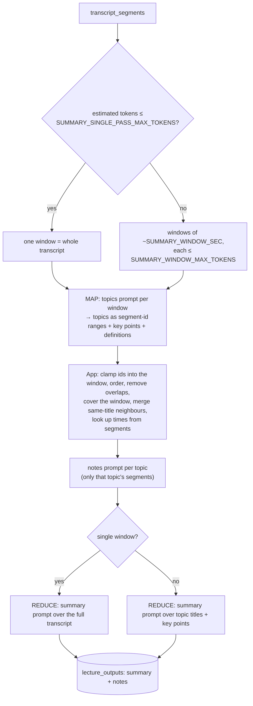

# Summary and notes (Phase 5)

How the app turns a transcript into a summary, key takeaways, definitions, topic-wise notes and revision notes, using only what the lecturer said.

Code: `backend/app/services/generation/summary.py` (generation), `backend/app/services/summaries.py` (caching and status), prompts in `backend/app/prompts/{topics,notes,summary}.yaml`.

## 1. What is produced

| Output | Where it comes from | Timestamps |
|---|---|---|
| `summary` (1–2 paragraphs) | `summary` prompt | – |
| `key_takeaways` (3–7 points) | `summary` prompt | – |
| `revision_notes_md` (Markdown sheet) | `summary` prompt | – |
| `definitions` (term, definition) | `topics` prompt | start of the segment the model points to; `null` if its id is invalid |
| `topics` (title, key points, `notes_md`) | `topics` prompt (ranges) + `notes` prompt (notes) | start of the first and end of the last segment of the topic |

## 2. Pipeline

Number of LLM calls for one lecture: `windows + topics + 1`. Every call is logged in `llm_calls` with `task` = `topics`, `notes` or `summary` and its `prompt_version`.

### Why the thresholds are lower than "12k tokens"

The plan suggested map-reduce only above about 12k tokens. On Groq's free tier, `openai/gpt-oss-120b` allows about **8K tokens per minute** (checked Nov 2026), and a single request larger than that is refused outright. So:

- `SUMMARY_SINGLE_PASS_MAX_TOKENS=3500`: roughly 15–20 minutes of speech fits one request together with the prompt and the answer.
- `SUMMARY_WINDOW_MAX_TOKENS=2500`: every map request stays well under the per-minute limit.
- The client paces requests (`GROQ_TOKENS_PER_MINUTE=8000`): when the last minute plus the next request would exceed the limit, it waits. Long lectures therefore take longer but do not fail. Groq's own 429 with `Retry-After` is still handled as a backstop.
- `LLM_REASONING_EFFORT=low`: gpt-oss writes hidden reasoning before answering, and those tokens count too. `low` keeps them small.

If you use a provider with higher limits (for example `LLM_PROVIDER=openai`, paid), you can raise these values in `.env`.

Token counts used for windowing and pacing are **estimates** (characters ÷ 4). Billing and the `llm_calls` table always use the provider's real counts.

## 3. Grounding rules

1. **The model sees segment ids, not times.** Each transcript line is sent as `[12] text`. The `topics` prompt asks for `start_segment`, `end_segment` and a `segment_id` per definition.
2. **The app turns ids into times** with the stored `transcript_segments`:
   - ids outside the window are clamped to the window,
   - reversed ranges are swapped, overlapping topics are trimmed, gaps are closed so the topics cover the lecture,
   - a definition whose id is not in its window gets `timestamp: null` (never a guess).
3. **Only lecture content.** All three prompts say: use only the transcript, add no outside knowledge, and write `(not stated in lecture)` where the lecturer leaves something incomplete. The model is also told not to write timestamps or segment ids in prose.
4. **Notes per topic see only that topic's segments**, so a topic's notes cannot drift into other parts of the lecture.
5. **JSON is validated** against Pydantic schemas (`TopicsOut`, `NotesOut`, `SummaryOut`). An invalid answer gets one repair attempt; a second failure returns `502 LLM_OUTPUT_INVALID`.

Grounding is enforced for structure and timestamps. Whether each sentence is faithful to the lecture is checked by reading it against the transcript (Phase 5 manual check) and, later, by the evaluation harness *(Phase 11, planned)*.

## 4. Caching, regeneration and status

- Results are stored in `lecture_outputs` (`kind=summary`, `kind=notes`), with the prompt version and model.
- `POST /api/lectures/{id}/summarize` returns the cached result instantly (`"cached": true`, no LLM calls) unless the body is `{"regenerate": true}`.
- Generation runs:
  - automatically after transcription when `SUMMARY_AUTO=true` (status `transcribed → generating → ready`), or
  - synchronously inside `POST /summarize` when there is no cached result or `regenerate` is true.
- Only one generation per lecture runs at a time; a second request gets `409 GENERATION_IN_PROGRESS`.
- If generation fails (rate limit after retries, model unavailable, invalid JSON twice):
  - a lecture without a summary returns to `transcribed` with `error` explaining what failed; the transcript stays available;
  - during a regeneration, the previous summary is kept and the lecture stays `ready`;
  - the API call returns the error envelope (for example `429 RATE_LIMITED`, which says that no paid fallback is used).

## 5. Prompt versions

| Prompt | Version | Role |
|---|---|---|
| `topics` | v1 | MAP: topics (segment ranges), key points, definitions |
| `notes` | v1 | Markdown notes for one topic |
| `summary` | v1 | REDUCE: summary, key takeaways, revision notes |

Change what a prompt does → bump its `version` (CLAUDE.md rule 5). The version is stored in `llm_calls.prompt_version` and in `meta.prompt_versions` of each result, so outputs from different prompt versions can be compared later.

## 6. Limitations

- Fixed-length audio chunks (Phase 4) can split a word at a chunk boundary; the summary is rarely affected.
- In map-reduce mode a topic that crosses a window boundary is merged only when the model gives both halves the same title.
- Summaries of very long lectures are built from topic key points, not the full text, so they are more compact than single-pass summaries.
- Long lectures on the free tier take minutes because of the tokens-per-minute pacing; `POST /summarize` with `regenerate=true` runs synchronously and can take as long. Quality and latency figures will be measured in the LLMOps dashboard (Phase 11), not estimated here.

## 7. How to try it

See [api.md](api.md#summary-and-notes) and the manual scripts:

| Windows (PowerShell) | macOS / Linux |
|---|---|
| `.\scripts\manual_phase5.ps1 -File C:\path\to\lecture.mp3` | `bash scripts/manual_phase5.sh /path/to/lecture.mp3` |
| `.\scripts\manual_phase5.ps1 -LectureId <id> -Regenerate` | `LECTURE_ID=<id> REGENERATE=true bash scripts/manual_phase5.sh` |

To try map-reduce on a short recording, start the server with small windows, e.g. `SUMMARY_SINGLE_PASS_MAX_TOKENS=300` and `SUMMARY_WINDOW_SEC=120`.
